# The Complete RAG Engineering Handbook

From fundamentals to production-grade retrieval systems. Detailed visual edition for senior AI / LLM engineer interviews.

**Reading path:** Chapters 1-9: core pipeline. Chapters 10-16: architecture choices. Chapters 17-23: evidence and evaluation. Chapters 24-30: production and implementation. Chapters 31-34: interviews and revision.

**Source boundary:** Based on the user-provided RAG master prompt. The original shared ChatGPT conversation returned HTTP 403 on both access attempts and could not be audited. This edition expands the supplied topic list; it does not claim to reproduce unseen chat content.

**Evidence boundary:** Enterprise facts, scores, capacities, prices and latency budgets are hypothetical examples, not benchmarks. Code labeled pseudocode is not runnable. The offline Python lab is runnable but is not a production platform. Verify current product details in official documentation.

**How to study:** Follow the arrows in each figure. Explain what happens before the query, during the query, and what is stored. Read the failure case. Then answer the interview question aloud.

## Contents

- [1. RAG fundamentals: what happens and why](chapters/01-foundations.md)
- [2. Requirements, capacity and system design](chapters/02-requirements.md)
- [3. Ingestion: files to searchable, versioned evidence](chapters/03-ingestion.md)
- [4. Chunking: boundaries, meaning and retrieval units](chapters/04-chunking.md)
- [5. Metadata, enrichment and query understanding](chapters/05-metadata.md)
- [6. Embeddings and vector search internals](chapters/06-vectors.md)
- [7. BM25, lexical indexes and exact matching](chapters/07-bm25.md)
- [8. Hybrid retrieval, rank fusion and candidate coverage](chapters/08-hybrid.md)
- [9. Reranking, diversity and context packing](chapters/09-reranking.md)
- [10. Standard vector RAG: the baseline architecture](chapters/10-naive-rag.md)
- [11. Production hybrid RAG: the default enterprise candidate](chapters/11-production-hybrid.md)
- [12. Vectorless RAG: retrieval without dense embeddings](chapters/12-vectorless.md)
- [13. GraphRAG: entities, paths and source-backed reasoning](chapters/13-graphrag.md)
- [14. Agentic RAG: bounded adaptive evidence gathering](chapters/14-agentic.md)
- [15. Other RAG patterns and what each changes](chapters/15-variants.md)
- [16. Architecture selection and decision rules](chapters/16-selection.md)
- [17. Evidence verification: relevance is only the beginning](chapters/17-evidence.md)
- [18. Grounded answer generation and safe release](chapters/18-generation.md)
- [19. Golden datasets and annotation](chapters/19-golden-data.md)
- [20. Retrieval metrics with worked calculations](chapters/20-retrieval-metrics.md)
- [21. Answer, evidence and safety evaluation](chapters/21-answer-metrics.md)
- [22. Agent evaluation: outcomes and trajectories](chapters/22-agent-eval.md)
- [23. Experiments, ablations and release decisions](chapters/23-experiments.md)
- [24. Deployment, APIs and operational ownership](chapters/24-deployment.md)
- [25. Performance, latency budgets and cost](chapters/25-performance.md)
- [26. Security, permissions and prompt injection](chapters/26-security.md)
- [27. Observability, reliability and incident response](chapters/27-observability.md)
- [28. Debugging: symptom to cause to prevention](chapters/28-debugging.md)
- [29. Implementation blueprint and runnable offline lab](chapters/29-implementation.md)
- [30. Five complete execution walkthroughs](chapters/30-walkthroughs.md)
- [31. A 60-minute senior system-design mock](chapters/31-mock-interview.md)
- [32. 150 interview questions and first-person answers](chapters/32-question-bank.md)
- [33. Architecture challenges and design responses](chapters/33-challenges.md)
- [34. Revision sheets, glossary, formulas and references](chapters/34-revision.md)

# 1. RAG fundamentals: what happens and why

## The problem before the solution
An LLM predicts tokens from its context and learned parameters. Its parameters are not a queryable, version-controlled copy of your company documents. Training may omit private material. Knowledge can be old. A plausible completion can be false. RAG supplies selected external evidence at answer time. It improves access to current knowledge, but retrieval mistakes and generation mistakes remain possible.

**Interview answer:** “I retrieve authorized, applicable evidence, then ask the model to answer from it with citations. I measure retrieval and answer quality separately. I do not assume that having a vector database means the answer is grounded.”


Read the figure as two clocks. Ingestion runs when sources change. Query processing runs when a user asks. The persistent stores connect them. Verification uses source metadata prepared earlier, but claim support depends on the current question and answer.

## One project, repeated throughout
Enterprise Knowledge Intelligence Platform: 1 million PDFs, DOCX, HTML, Markdown and scans; financial tables; HR/legal/security policies; many tenants; 100,000 queries/day; frequent updates; citations; multi-hop questions. These are hypothetical requirements.

Question A: “Can a Pakistan employee carry unused leave into 2027?” Question B: “Which vendors used by Team Atlas are affected by the new retention policy?” Question C: “What does section 7 of HR-42 version 3 say?” These questions stress applicability, relationships and exact lookup respectively.

## Knowledge, retrieval and reasoning
Parametric knowledge lives in model weights. External knowledge lives in files, records and indexes. Retrieval selects evidence; reasoning combines evidence and derives conclusions. A retriever cannot prove a numerical calculation. A fluent generator cannot establish that a cited source exists. Use deterministic tools for arithmetic and authoritative record queries.

Tokens are model-specific units, not words. The context window holds instructions, history, evidence and output budget. Reserve space for the answer. “Fits in context” does not mean “the model reliably uses every fact.” Large distracting contexts can reduce accuracy.

| Choice | Best fit | What it does not solve |
|---|---|---|
| RAG | Fresh/private source-grounded answers | Bad sources, weak retrieval, unsupported reasoning |
| Fine-tuning | Style, tool behaviour, specialized task patterns | Reliable per-document updates, citations or deletion |
| Long context | A small known set of relevant documents | Selecting authorized/current sources at large scale |
| Search interface | Users want to inspect documents | Multi-source answer synthesis |
| SQL/tools | Exact structured facts and computations | Unstructured discovery without a retrieval layer |

Naive RAG is retrieve once then generate. Advanced RAG improves parsing, retrieval, reranking and context. Modular RAG separates these functions so you can replace or route them. These are useful design categories, not standardized protocol names.

**Failure:** A model answers from old memory despite a new policy in context. **Fix:** Strengthen evidence selection and prompting, check material claims, test conflicting-version cases, and abstain if the current evidence is insufficient.

**Follow-up:** “Does RAG prevent hallucinations?” **Response:** “No guarantee. I can enforce source access, validate citations, measure unsupported claims and limit answering when evidence is weak.”


# 2. Requirements, capacity and system design

## Clarify the workload
Ask who uses the system, what they can access, which answers need citations, what freshness means, what languages/file types exist, and which actions are allowed. Define availability and latency targets separately for interactive answers and research tasks. Define whether uncertain cases should abstain or escalate. Agree on source authority and effective-date semantics.

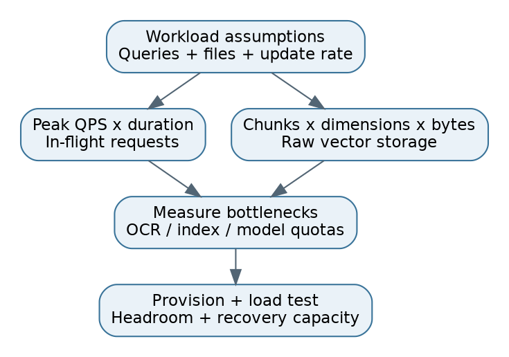

Functional requirements: ingest/update/delete; retrieve within permission scope; answer with applicable citations; handle follow-ups and multi-document questions. Nonfunctional requirements: isolation, recoverability, freshness, bounded spend, observable failures and measurable answer quality.

## Capacity calculations
Average QPS = 100,000 / 86,400 = 1.16. Peak QPS cannot be inferred from that average. Suppose a measured or explicitly assumed peak is 20 QPS and mean request duration is 3 seconds. Little's law gives about 60 requests in flight in a stable interval: concurrency = arrival rate x mean duration. This is not a tail-latency guarantee. Retries, bursts and model limits require headroom.

Suppose 1 million documents average 20 chunks: 20 million vectors. At 768 dimensions, float32 raw vector bytes = 20,000,000 x 768 x 4 = 61.44 GB, about 57.2 GiB. Add index structures, metadata, text, lexical postings, replicas, temporary rebuild space and backups. Sample pages and chunk counts before committing to this estimate. Scanned-page OCR throughput may dominate ingestion more than embeddings.

For an ingestion deadline, workers needed approximately equal total processing seconds / deadline seconds / effective utilization. Measure file-type distributions, provider quotas and memory requirements. More workers do not help if one embedding endpoint is throttled.

## Architecture and storage ownership
Object storage retains original bytes and parsed layout. PostgreSQL tracks documents, versions, chunks, ACLs, jobs and publication state. Search indexes hold retrievable representations. An optional graph store holds source-backed relationships. A cache stores replaceable results, never the only copy of authoritative data.

An SLO must specify the denominator and window. Example, not a recommendation: “99% of successful interactive requests complete within the agreed deadline over a month.” Track errors and abstentions separately so rejecting hard requests cannot fake good latency or quality.

**Interview answer:** “I size from chunks, bytes, query mix, peak traffic and update rate. I choose the simplest pipeline that meets measured quality and isolation requirements. The first design is a hypothesis, not a benchmark.”

**Follow-up:** “What do you build first?” **Response:** “Representative ingestion, permission-aware lexical and dense baselines, and a labeled evaluation set. I postpone graphs and agents until their target query slices justify them.”

**Failure:** A design meets average QPS but collapses at office opening. **Debug:** Inspect request arrival distribution, queue wait and provider rate limits. **Prevention:** Load-test realistic bursts, apply backpressure, set admission limits and protect the interactive path from bulk ingestion.


## Additional visual walkthrough

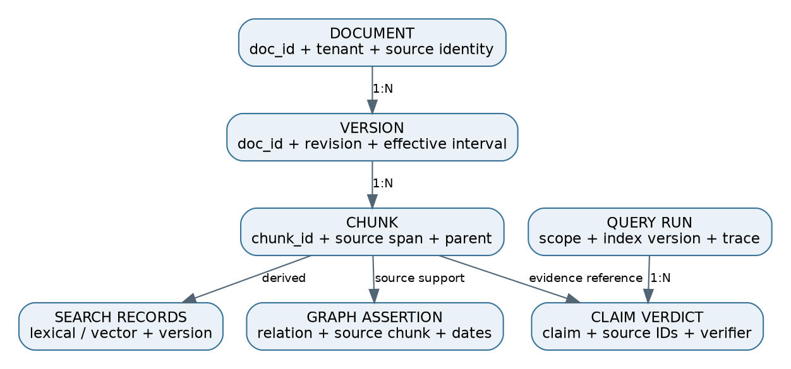

## Quantitative storage visual

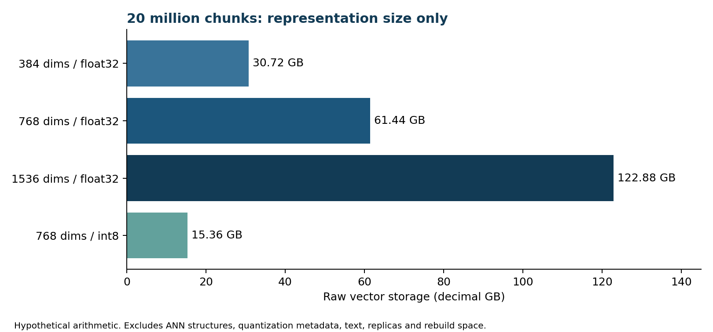

Only the vector payload is counted. Compression may change retrieval quality and add codebook/scale metadata. Lower raw bytes do not prove lower total system cost. Text, graph, replicas and index structures remain outside these bars.


# 3. Ingestion: files to searchable, versioned evidence


## Step-by-step pipeline
1. A connector reads a permitted source through an API, batch scan, stream or CDC event. Capture source ID, revision, tenant and change time. Use checkpoints so restarts resume safely.
2. Save original bytes in object storage. Enforce file size/type, decompression and parser limits. Documents are untrusted inputs.
3. Parse text, headings, page locations, tables and images. DOCX has logical structure; PDFs may have visual layout without semantic order. HTML needs main-content extraction, link handling and boilerplate removal. Markdown headings are useful boundaries.
4. OCR scanned pages, retaining coordinates and confidence indicators. Sample outputs with numbers, columns and unusual fonts. OCR can turn “10” into “IO”; retrieval quality cannot repair corrupted facts reliably.
5. Normalize whitespace, encoding and repeated headers carefully. Preserve units, punctuation in IDs, table labels and meaningful code indentation.
6. Hash content and compare revisions. Deduplicate within valid ownership/access boundaries. Identical text across tenants does not authorize merging their permissions.
7. Chunk, enrich and index. Preserve source spans from normalized chunks back to original pages or sections.
8. Validate the new version. Publish only after all required stores are ready. Readers resolve a complete manifest or active alias, never a partly written version.

## Idempotency and retries
Use an idempotency key such as tenant + source ID + source revision + pipeline version. Queue delivery is often at least once. A repeated event should upsert the same pending version rather than create another active copy. Persist job stages and errors. Retry transient failures with bounded exponential backoff and jitter. Put invalid documents in a dead-letter queue with safe diagnostics and source references.

Cross-store writes rarely share one transaction. Use an outbox/job state machine and reconciliation: pending -> parsed -> indexed -> validated -> published. A worker crash between vector and lexical writes must be discoverable. Only the manifest switch makes the version visible.

## Freshness, update and delete
Store both ingestion time and effective time. A file uploaded today can describe last year's policy. For incremental updates, reprocess changed sections only when chunk identities and boundaries remain valid. A parser/chunker/model change may require a versioned rebuild even if raw bytes did not change.

Permission revocation should block access promptly through an authoritative scope check or tombstone. Do not wait for embeddings to be regenerated. Deletion covers chunks, vectors, graph facts, community summaries, cached answers, derived artifacts and the applicable backup-retention process. Track completion, not just the original delete event.

**Stored:** Original bytes, parse/layout artifacts, content hashes, source revisions, pipeline versions, job history, publication manifest and provenance. **Runtime:** Resolve only accessible published versions. **Evaluation:** Measure source-change-to-searchable delay, duplicate active records, parsing accuracy, failed-job age and revocation delay.

**Interview answer:** “Ingestion is a versioned state machine. I make each stage retry-safe, validate complete outputs, and publish atomically through a manifest.”

**Follow-up:** “A new index is 90% complete. Can we use it?” **Response:** “Not as the complete version. Keep the previous valid index active or expose explicitly scoped partial results only under a defined product contract.”


# 4. Chunking: boundaries, meaning and retrieval units

## What chunking actually changes
A chunk is a retrievable unit, not necessarily the final context unit. Its size changes term statistics, semantic specificity, number of vectors, reranking cost and citation granularity. The right boundary keeps a fact with its conditions: “five days” without “eligible permanent staff only” is incomplete evidence.

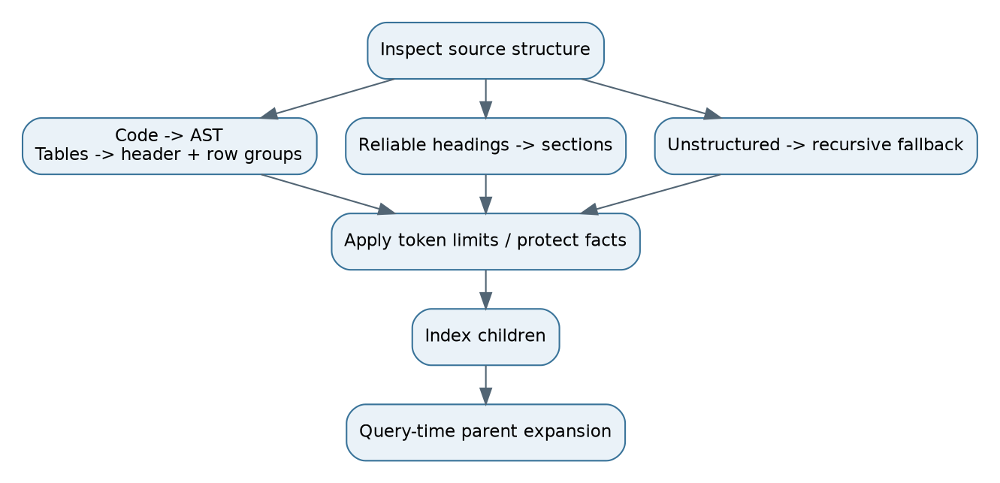

## Families and internal working
| Technique | How boundaries are chosen | Cost and main failure |
|---|---|---|
| Fixed characters | Cut every n characters | Cheap; token length varies and sentences break |
| Fixed tokens | Tokenize, take bounded windows | Predictable budget; semantic boundaries ignored |
| Sliding window | Advance by size minus overlap | Repeated facts raise storage and duplicate context |
| Sentence/paragraph | Detect language-aware boundaries, then pack | Natural units; abbreviations and long paragraphs need handling |
| Recursive | Try heading, paragraph, sentence, then token splits | Strong baseline; quality depends on parser/separators |
| Heading/Markdown | Preserve heading paths and blocks | Good structure; weak or fake headings mislead |
| HTML/DOM | Traverse meaningful content nodes | Navigation/ads can pollute text; reading order matters |
| JSON | Split by records or key subtrees; retain key paths | Splitting values from keys destroys interpretation |
| Table-aware | Keep headers/units with row groups | Repeated headers add tokens; huge tables need SQL |
| AST/code | Function/class/symbol boundaries plus file context | A function may depend on imports or another file |
| Semantic | Split where adjacent text embedding similarity falls | Extra inference; topic change is not always a safe fact boundary |
| Proposition | Extract atomic factual statements | Precise matching; extraction may omit conditions or invent facts |
| Parent-child | Index small children and link to larger parents | Better recall/reading balance; expansion needs a budget |
| Sentence-window | Index sentence; fetch nearby sentences | Context can cross headings or authorization boundaries |
| Hierarchical | Store document -> section -> chunk relationships | Multiple levels help routing but create update complexity |
| Contextual | Prefix chunk with document/section explanation | Generated prefix can be false; preserve original source |
| Late chunking | Encode long text, then pool token vectors by span | Requires suitable model/token representations; not ordinary post-embedding splitting |
| LLM/agentic | Ask model to identify coherent units | Cost, repeatability and provenance validation required |
| Multimodal | Link text, image regions and table areas | Need modality-compatible encoders and location metadata |
| Adaptive/query-aware | Select or reshape passages after query arrives | More runtime latency and no single fixed index unit |
| Document/section | Index a larger logical unit directly | Useful for short content/routing; mixed topics reduce precision |

## Semantic breakpoints, precisely
Encode adjacent sentences or small sentence windows, then compute distance d_i = 1 - cosine(e_i, e_(i+1)). A high distance suggests a topic change. A percentile method splits above a selected distance percentile. A standard-deviation method splits above mean(d) + a x std(d). Neither threshold guarantees meaningful boundaries. Percentiles can force splits in a uniform document; standard-deviation rules can produce none. Enforce minimum/maximum sizes and preserve tables or clauses as protected spans.

## Size and overlap experiment
Compare 128, 256, 400, 512, 800 and 1024 tokens using the actual tokenizer. Those are experimental candidates, not default recommendations. For each, measure candidate recall, required-fact coverage, final answer quality, context tokens, index size and P95 latency. Evaluate exact IDs, explanations, tables and multi-hop questions separately.

Approximate window count for L tokens, size s and overlap o is ceil((L-s)/(s-o))+1 when L>s and 0<=o<s. A 2,000-token text with size 500 and overlap 100 produces 5 windows: starts 0,400,800,1200,1600. The final one may be shorter. Exact counts vary when structure changes boundaries.

```python
# Illustrative token-window primitive; tokenizer supplied by caller.
def windows(tokens, size, overlap):
    if not 0 <= overlap < size:
        raise ValueError("Require 0 <= overlap < size")
    start = 0
    while start < len(tokens):
        yield tokens[start:start + size]
        if start + size >= len(tokens):
            break
        start += size - overlap
```

## Stored vs runtime
Persist chunk ID, original text, token count, source/page offsets, parent ID, heading path, version and access metadata. Precompute embeddings for the indexed representation. At runtime retrieve small children, authorize parent access, expand only useful context, then deduplicate overlapping spans. Do not send every retrieved parent in full.

**Interview answer:** “I start with structure-aware recursive chunking, test sizes and overlap, then add parent expansion for observed boundary failures. Parent-child and recursive are compatible: one defines retrieval/context levels, the other defines boundaries.”

**Follow-up:** “Why not semantic chunking everywhere?” **Response:** “It adds processing and threshold sensitivity. I need evidence that it improves full-fact retrieval over the simpler baseline, including exceptions and tables.”


## Additional visual walkthrough

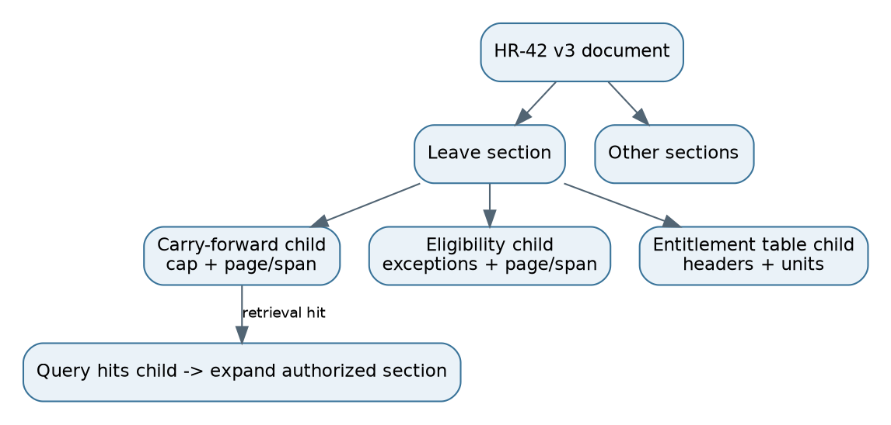

## Boundary algorithms in practical detail

### Fixed, recursive and structure-aware example
Suppose a source says: heading “Carry forward”; paragraph “Eligible permanent employees may carry five days”; paragraph “Contractors are excluded”; a table lists expiry dates. A fixed window may cut before the exception. A recursive splitter first keeps the section, then packs paragraphs while under its limit. A structure-aware variant treats the table as protected and repeats its header in each row group. Store the heading path on every child so a hit can expand to the right context.

For a recursive implementation, represent parsed blocks as `(type, text, source_span, heading_path)`. Try to pack whole blocks. If one block exceeds the limit, choose a type-specific split: sentences for prose, row groups for a table, statements/symbol blocks for code. Only fall back to raw token cuts when no safe structural boundary exists. Every derived span needs a valid source mapping. This is why parsing quality precedes clever chunking.

### Sentence, paragraph and window example
Sentence splitting needs language-aware handling for abbreviations, initials and decimal values. A naive split on `.` can break “Dr. Khan,” “U.S.” and “3.5%.” Pack sentences until the token cap, then optionally retain a short trailing overlap. Sentence-window retrieval stores a sentence ID and neighbours rather than permanently duplicating every window. At query time fetch neighbour spans within the same permitted section/version and merge overlapping windows.

### Semantic example
For adjacent window similarities [0.92, 0.90, 0.41, 0.88], distances are [0.08, 0.10, 0.59, 0.12]. The large 0.59 suggests a possible boundary. It is not proof: the second passage might contain an exception using different vocabulary. Evaluate complete clause coverage and not only perceived topic coherence. Percentile thresholds depend on available distances; a very short document provides poor distribution estimates.

### Proposition and contextual example
Original: “Permanent Pakistan staff may carry five days, unless their contract states otherwise.” A safe proposition preserves subject, region, cap and exception. “All staff may carry five days” is an extraction error. Contextual enrichment might prefix “HR-42 v3, Pakistan leave rules, effective 2027.” If this prefix comes from a wrong summary, the indexed meaning becomes misleading even though the source passage was correct. Persist original and enrichment separately, with provenance.

### Late chunking example
Ordinary chunking encodes `[paragraph A]` and `[paragraph B]` separately. Late chunking encodes the longer combined text first so contextual token representations for B can reflect an entity named in A, then pools token spans into chunk vectors. This requires access to appropriate token-level model outputs and a pooling method consistent with the model. It is limited by the encoder's context window and may not work through a simple hosted endpoint that returns only one vector per input.

### Code, JSON and table examples
An AST splitter identifies a function/class and retains symbol/file metadata. If a function exceeds the limit, split along syntax blocks while retaining signature and necessary context; do not execute source code during parsing. A JSON splitter emits records with key paths such as `employees[17].leave_policy`, preserving units and object identity. A table splitter repeats column labels like `Region | Employee type | Cap (days) | Effective date`; keep a row's values together and cite original cells/coordinates.

### Multimodal and adaptive example
An image chunk may include a page crop, caption, OCR text and bounding box. A multimodal encoder matches visual content while the answer cites the original region. Validate visual facts with the appropriate model/tool; an OCR-only route cannot see a chart's unlabeled trend reliably. Adaptive chunking may retrieve a coarse section, then choose query-relevant spans at runtime. It saves final context tokens at the cost of another processing step; cache only under correct query/scope/version semantics.

### How to compare all methods fairly
Keep the same document versions and golden questions. Count required facts, not just relevant chunk IDs, because changing boundaries changes IDs. Report indexing/model calls, raw and derived storage, candidate token totals, final context size and answer metrics. A method that produces more labeled chunks can look better under raw chunk recall while adding no new supported facts. Include answer-spans that cross boundaries, long exceptions, tables, multilingual content and malformed structure.


# 5. Metadata, enrichment and query understanding

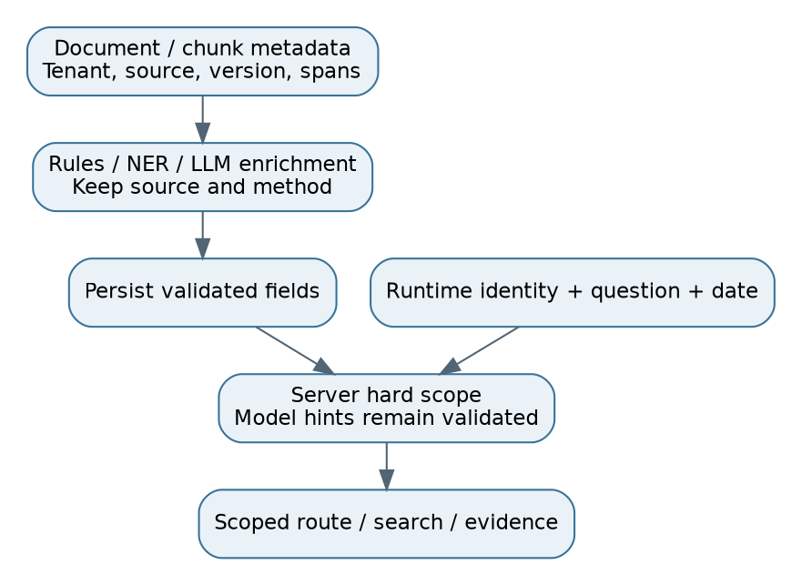

## Three different metadata layers
Document metadata identifies owner, source, authority, language, version, effective dates and access policy. Chunk metadata adds heading path, page/span, parent, entities and indexed representation version. Query metadata describes authenticated identity, allowed scope, requested time, language, intent and extracted identifiers. These layers have different trust levels.

```json
{
  "chunk_id": "hr42:v3:s7:c2", "doc_id": "hr42", "version": 3,
  "tenant_id": "t1", "allowed_groups": ["employees-pk"],
  "parent_id": "hr42:v3:s7", "heading_path": ["Leave", "Carry forward"],
  "text": "Up to five days ...", "page": 8,
  "source_uri": "object://t1/hr42/v3.pdf",
  "effective_from": "2027-01-01", "effective_to": null,
  "content_hash": "sha256:...", "pipeline_version": "parse4-chunk2",
  "embedding_model": "model-A-v1", "authority": "approved-policy"
}
```

Source references must resolve to access-checked content; a citation URL must not bypass storage authorization. Store exact spans when feasible, not just page numbers. Generated enrichment belongs in a separate field from original evidence.

## Enrichment methods
Rules extract stable IDs, dates and known patterns cheaply. NER finds candidate people, organizations and locations. LLMs can infer topics and relations, but require schema validation, source grounding and error sampling. Store extraction method, version, source span and uncertainty. A model-supplied confidence value is not automatically calibrated.

Contextual prefixes explain where a chunk belongs, such as “HR-42, 2027 Pakistan leave policy, carry-forward section.” Build prefixes from reliable headings/metadata where possible. If generated, verify they do not change meaning. Index the prefix but cite original text.

## Query transformations and risks
Rewriting resolves shorthand or conversation references: “What about contractors?” becomes a search question linked to the previous policy topic. Keep the original query for auditing; a rewrite can change intent. Expansion adds synonyms or related terms. Multi-query retrieves several reformulations and merges results. Decomposition makes dependent subquestions for a multi-hop task. Each raises recall potential and query cost.

HyDE generates a hypothetical answer/document, embeds it, then retrieves real evidence. The hypothetical text is a search aid, never evidence. It may steer toward plausible but wrong assumptions. Compare against simpler query expansion.

Routing chooses exact lookup, lexical, vector, hybrid, graph or SQL based on task and measured performance. A classifier should have a fallback route. A wrongly predicted topic should usually be a soft boost, not an irreversible exclusion.

Hard filters enforce tenant, access, explicit version/date and other certain requirements. Soft filters boost likely topic/source preferences. Resolve access from the server identity, never from generated query text. Date filters must distinguish publication, ingestion and effective dates.

**Interview answer:** “Metadata is not just tags. It connects retrieval, versioning, provenance and authorization. I separate trusted scope from model-inferred hints.”

**Follow-up:** “Can the model choose filters?” **Response:** “It can propose business filters through a schema. The server validates them and always adds non-negotiable access constraints.”


# 6. Embeddings and vector search internals

## Representations
Dense embeddings encode text into fixed-length vectors. Sparse learned representations assign weights to vocabulary features. Multi-vector/token representations retain several vectors per passage for more detailed matching. Do not treat these as interchangeable storage or scoring formats.

A bi-encoder embeds queries and documents separately, allowing document representations to be precomputed. A cross-encoder reads the pair together at runtime and is normally used after candidate retrieval. Follow the model's required prefixes, tokenizer, maximum input length and pooling method. Silent truncation can drop the answer before indexing.

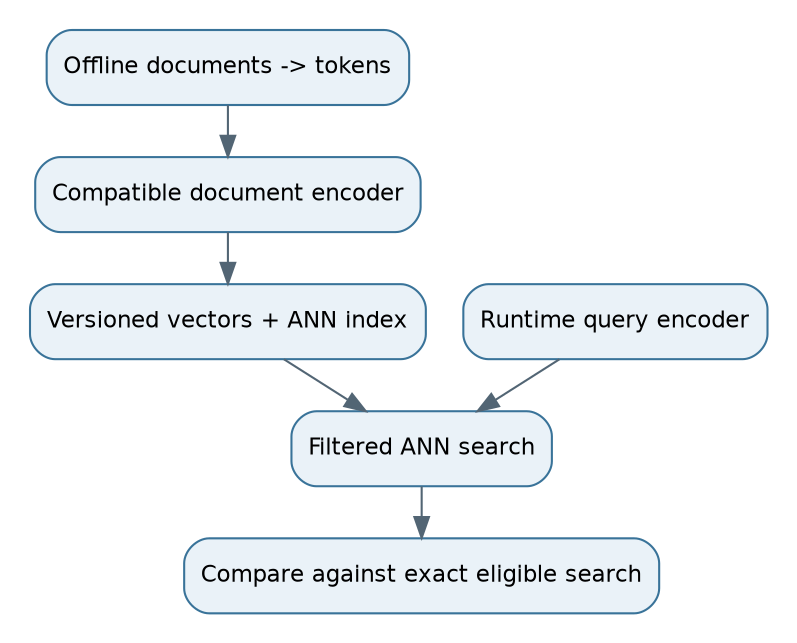

## Geometry and worked math
dot(q,d) = sum_i q_i*d_i. cosine(q,d) = dot(q,d)/(norm(q)*norm(d)). For q=(1,0) and d=(1,1), dot=1 and cosine=0.707. Euclidean distance=sqrt(sum_i(q_i-d_i)^2)=1. With unit-normalized vectors, squared Euclidean distance=2-2*cosine. These rankings can agree under normalization, but raw dot products also reward magnitude. A cosine score is not a probability of truth. Handle zero vectors explicitly.

## Approximate nearest neighbours
Exact search compares against all eligible vectors; useful as an evaluation reference on manageable samples. ANN skips much of that work and trades recall for speed.

HNSW builds a layered proximity graph. Search starts at sparse upper layers, descends toward neighbours, then explores a candidate frontier. Construction connectivity and construction effort affect memory/build quality; search effort affects runtime recall. Parameter names differ by implementation.

IVF clusters vectors into cells. At query time, probe selected cells, then rank vectors within them. More probed cells usually improve recall and increase work. Poor training data or embedding drift can make partitions uneven. PQ approximates vectors by codebook entries for subvectors, reducing memory at a possible accuracy cost. Scalar quantization lowers per-dimension precision. Evaluate both ANN recall and downstream answer quality.

## Filtering and model migrations
Post-filtering a small global candidate set can lose all permitted hits for a restrictive tenant. Use supported filter-aware search, appropriate partitioning or exact search for tiny eligible sets. Test realistic high- and low-selectivity ACLs; unfiltered recall is insufficient.

When changing model/dimensions/normalization, build a new versioned index and query with its matching model. Never mix incompatible spaces just because dimensions match. Dual-run evaluation, publish the new manifest, then retire the old index. Track language/domain drift and changed score distributions.

| Option | Useful starting context | Operational question |
|---|---|---|
| FAISS | Embedded/local search library | Who supplies persistence, access control, serving and recovery? |
| pgvector | PostgreSQL-centric application | How do filtered ANN, SQL load and index growth interact? |
| Qdrant / Milvus | Dedicated vector workloads | How do filtering, partitioning, replication and updates behave? |
| Pinecone | Managed vector service | What are current cost, isolation, limits and residency options? |
| Weaviate | Schema/object-oriented search needs | Which search modules and deployment guarantees are required? |
| OpenSearch | Lexical and vector in one search platform | How do shard layout and hybrid features behave at the chosen version? |

**Interview answer:** “I select the embedding on representative multilingual/domain queries, then select ANN parameters against an exact-search baseline. I choose a database on filters, operations and recovery as well as recall/latency.”

**Failure:** A model upgrade reduces exact-ID retrieval. **Action:** Slice evaluation by query type, retain lexical search, and compare tokenization/truncation and domain representation before blaming ANN.


# 7. BM25, lexical indexes and exact matching

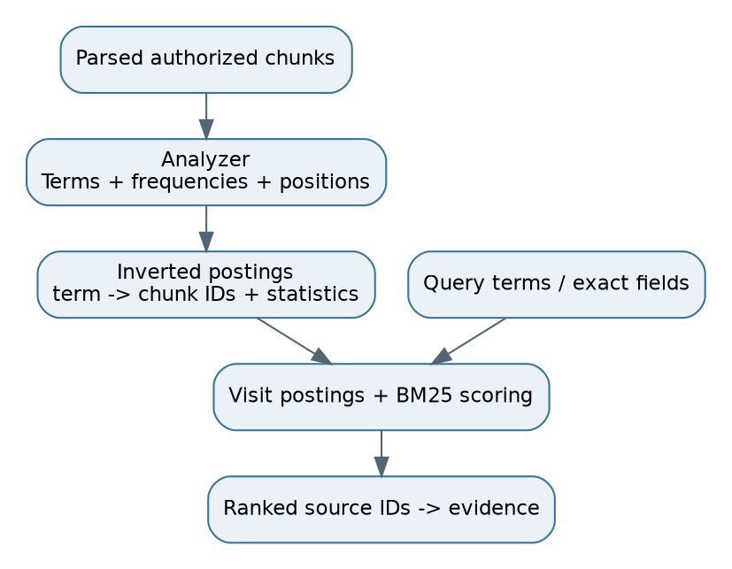

## Ingestion and data structures
An analyzer turns text into terms using tokenization, case handling and optional stemming/synonyms. The inverted index maps term -> postings of document/chunk IDs, frequencies and sometimes positions. It stores corpus statistics such as document frequency and average length. At runtime, search reads query-term postings and scores candidates; it does not scan and parse all source PDFs.

Use separate exact keyword fields for HR-42, invoice numbers, code symbols and versions. An analyzer that splits punctuation or stems aggressively can ruin identifier matching. Phrase queries require positional information. Synonym expansion must be controlled; two business terms that look similar can be legally different.

## Formula and full numerical example
BM25(q,d) = sum_t IDF(t) x [tf(t,d)*(k1+1)] / [tf(t,d) + k1*(1-b+b*len(d)/avglen)].

A common nonnegative IDF variant is ln(1+(N-df(t)+0.5)/(df(t)+0.5)). tf is term frequency in this unit, df is number of indexed units containing the term, and N is total indexed units. k1 controls saturation; b controls length normalization. Implementations and query-term weighting vary.

Hypothetical corpus: N=100 chunks. “carry” appears in 10; “leave” appears in 50. In chunk A, their term frequencies are 3 and 2. len(A)=avglen, k1=1.2, b=0.75. IDF(carry)=ln(1+90.5/10.5)=2.264; factor=3*2.2/(3+1.2)=1.571; contribution=3.557. IDF(leave)=ln(1+50.5/50.5)=0.693; factor=2*2.2/(2+1.2)=1.375; contribution=0.953. Total about 4.51.

If length doubles, normalization term rises from 1.2 to 2.1. For “carry,” factor becomes 6.6/5.1=1.294, lowering its contribution to about 2.93. This is how BM25 discourages long units from winning just because they contain more words. Values are illustrative, not recommended tuning constants.

TF-IDF also combines frequency and rarity but lacks BM25's particular saturation and length normalization structure. Neither understands paraphrases by itself. Dense retrieval can complement them.

## Document vs chunk indexes
Whole-document indexing helps title/topic discovery but dilutes a local clause. Chunk indexing finds local evidence and provides precise citations but loses broader context. Hierarchical search can rank documents then sections, or combine results from both levels. If stage one omits the correct document, later section search cannot recover it; evaluate this gate separately.

Field boosts change ranking, not evidence validity. A title match can be useful but does not prove the body answers the question. Tune analyzer, fields and boosts on exact-ID and semantic slices.

**Interview answer:** “BM25 is a strong lexical baseline, especially for rare terms and identifiers. Its speed comes from the inverted index and search-engine execution optimizations, not from reading every file per query.”

**Follow-up:** “Can BM25 power RAG without vectors?” **Response:** “Yes. Retrieve authorized lexical passages, expand context if needed, verify evidence, then generate with citations. Embeddings are optional, not the definition of RAG.”


# 8. Hybrid retrieval, rank fusion and candidate coverage

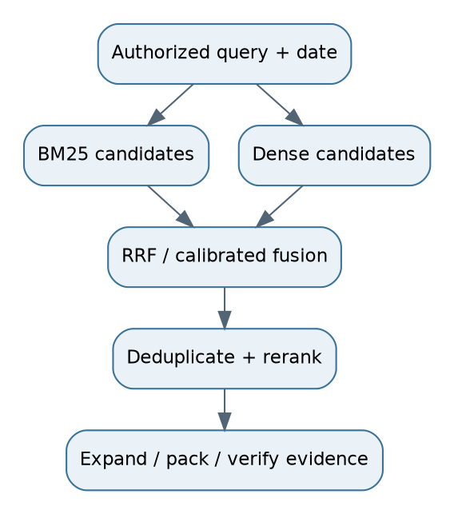

## Full data movement
Ingestion builds lexical and dense representations from version-aligned chunks. Persist identical stable IDs, tenant, permissions and source version in both indexes. Runtime resolves scope once, sends lexical and vector searches in parallel with enforced filters, fuses results, removes duplicate IDs/spans, reranks, expands authorized parents and packs evidence.

Hybrid helps when errors differ: exact policy code in BM25, paraphrased meaning in dense search. It is not guaranteed better. A noisy branch can add irrelevant candidates, and fusion may bury a rare correct result. Evaluate union recall and final ranking separately.

## RRF worked example
Reciprocal rank fusion: RRF(d)=sum_j w_j/(c+rank_j(d)). Missing results contribute zero. Rank starts at 1. With equal weights and illustrative c=60:

| Candidate | BM25 rank | Dense rank | RRF score |
|---|---|---|---|
| A | 1 | 3 | 1/61 + 1/63 = 0.03227 |
| B | 2 | 1 | 1/62 + 1/61 = 0.03252 |
| C | 3 | absent | 1/63 = 0.01587 |
| D | absent | 2 | 1/62 = 0.01613 |

Fused order is B,A,D,C. RRF uses ranks so a BM25 score of 12 is not compared directly to cosine 0.8. c controls how strongly top-rank differences matter. Choose it on validation data; it is not a confidence threshold.

Weighted score fusion can work if normalization and calibration are appropriate. Min-max scores within a tiny result list can be unstable. Calibrated relevance probabilities require labels and drift monitoring. Do not interpret an arbitrary blend as answer certainty.

## Following the candidates
Illustrative plan: lexical top 40 + dense top 40 -> 55 unique IDs -> rerank -> 6 useful passages -> expand two parents -> trim overlaps -> final context. These are tunable experiment values. Track a relevant chunk through every stage. If it disappears before generation, identify the exact stage rather than only checking the final answer.

Parallel wall time is approximately the slower retrieval branch plus overhead, subject to shared resource contention. Set branch deadlines. If one branch fails, use the other only under a tested degraded-mode policy; do not silently claim full retrieval coverage.

**Stored:** Both indexes, shared chunk IDs and model/analyzer versions. **Runtime:** Access scope, candidate lists, fusion and reranking. **Audit:** Search parameters, source IDs and rank transitions, without unnecessary sensitive text.

**Interview answer:** “I use hybrid when keyword and semantic queries coexist. I measure candidate recall before reranking and final evidence quality afterward. More candidates are useful only when they add missing relevant evidence.”

**Follow-up:** “Why not add raw scores?” **Response:** “They have different units and distributions. RRF avoids that comparison. Score fusion needs a deliberately validated normalization or calibration strategy.”


# 9. Reranking, diversity and context packing

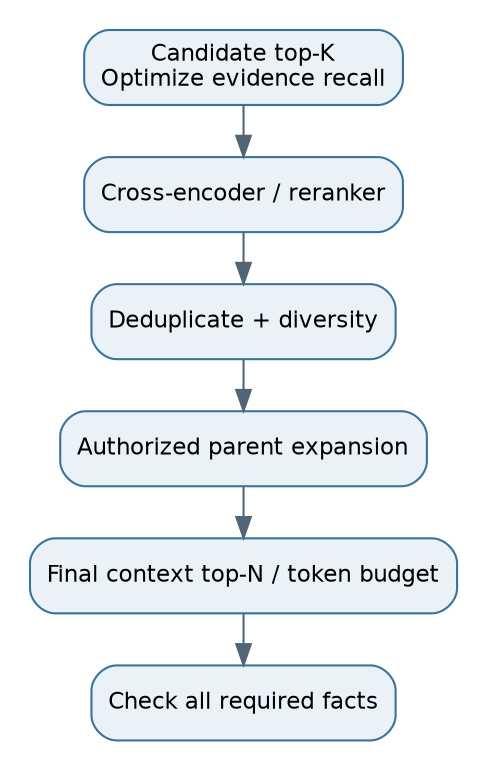

## Top-K is not top-N
K is how many candidates retrieval exposes to later stages. N is how many passages survive selection for evidence/context. Bigger K may improve recall but increases reranking work. Bigger N can increase coverage but also token cost and distraction. Neither should be selected by repeating a fashionable default.

A bi-encoder compares separately precomputed representations. A cross-encoder jointly reads query and candidate, allowing detailed token interactions at runtime. That is why it is often more expensive per candidate and useful after search. It cannot recover a passage retrieval never returned. Truncation inside the reranker can hide a late sentence even if the stored chunk is complete.

ColBERT-style late interaction separately encodes token vectors and aggregates token matches at query time. It is neither a single-vector embedding lookup nor a normal full cross-encoder. Its richer representation brings storage/serving trade-offs. LLM rerankers can use instructions and compare lists but add inference, order bias and prompt-injection exposure. Pairwise compares pairs; listwise ranks a set; pointwise scores each independently.

## Scores and thresholds
A relevance score measures the model's matching objective. Even a sigmoid output is not necessarily calibrated for your dataset. Select thresholds using held-out labels, inspect false positives by source/date/query slice, and monitor after upgrades. Relevance does not prove sufficiency, truth, authority or authorization.

## Context algorithm
1. Remove duplicate chunk IDs and overlapping spans.
2. Group by source/version and preserve essential qualifiers.
3. Select complementary evidence for each required fact.
4. Expand parents/neighbours only when needed and authorized.
5. Fit the model-specific token budget, including instructions, history and output reserve.
6. Attach stable citation IDs and preserve source boundaries.

MMR can select argmax of lambda*relevance(query,d) - (1-lambda)*max_similarity(d,selected). It trades relevance against redundancy. Lambda is a tunable diversity preference, not a probability. Do not discard an exception just because it resembles the main policy clause.

“Lost in the middle” describes failures to use information in long contexts. Order evidence deliberately, reduce distraction and evaluate order effects. Do not rely on one fixed placement trick for all models.

Example for A: One passage states the five-day cap; another says contractors are excluded; a third gives the effective date. A top-three list containing three paraphrases of the cap has less answer coverage than these complementary passages.

**Interview answer:** “I optimize context for sufficient, applicable facts per token. Ranking is only one input. I preserve conditions, dates and citations while removing redundant text.”

**Failure:** Great candidate recall but poor answers. **Debug:** Compare candidate -> rerank -> packed-context recall, inspect truncation and missing exceptions, then inspect generation. **Follow-up:** “Would increasing K fix it?” **Response:** “Only if the evidence was missing from candidates. It cannot repair a packing or verification bug.”


# 10. Standard vector RAG: the baseline architecture

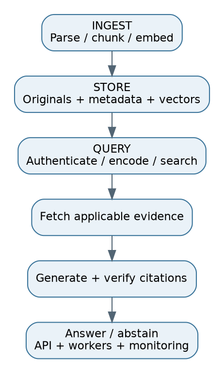

## Complete path
Ingest: authorized connector -> parse/OCR -> normalize -> version -> chunk -> embed. Store original bytes, chunk text/metadata and vectors. Publish the index version. Query: authenticate -> resolve scope and date -> encode query -> filtered vector search -> fetch source chunks -> check evidence -> generate with citations -> verify -> answer/abstain. Deploy an API, ingestion workers, persistent stores and model adapters; restart processes independently from stored indexes.

The word “standard” describes the retrieval core, not permission to omit security or evidence checks. A teaching diagram often shows only embed -> retrieve -> generate; a real answer service needs the rest.

## Question A walkthrough
The model embeds “Can a Pakistan employee carry unused leave into 2027?” Semantic neighbours include leave entitlement, carry-forward and general benefits. Resolve tenant and employees-pk access before exposing text. Retain the correct policy version effective at the requested time. If the top hits contain the cap but not eligibility, retrieve related context or abstain on eligibility rather than guess.

## Benefits and limits
This architecture is easy to implement and useful for paraphrase-heavy passage questions. Weaknesses include exact IDs, incompatible query/document representation, poor chunk boundaries, restrictive filters, and multi-hop tasks where no single passage answers the question. One top chunk can be relevant without being sufficient.

Tune the model, chunking, ANN parameters and K using labeled queries. First compare exact vector search to ANN on a manageable eligible subset; then distinguish embedding quality from ANN recall loss. Add complexity only after identifying the failing stage.

**Pseudocode:** `scope = authorize(identity); hits = vector_search(embed(query), scope); evidence = validate(fetch(hits)); draft = grounded_generate(evidence); return verify(draft)`.

**Evaluation:** Candidate recall, final-context coverage, supported answer correctness, authorization, freshness, latency and cost. **Failure:** The correct passage ranks below the cutoff. Check exact vector rank, ANN recall, filters and query interpretation before increasing K blindly.

**Interview answer:** “Vector RAG is my semantic baseline. It is a retrieval choice inside a larger versioned, permission-aware evidence system.” **Follow-up:** “When do you replace it?” **Response:** “I first test adding lexical retrieval or better context selection. I do not jump directly to agents when the actual failure is exact-ID matching.”


# 11. Production hybrid RAG: the default enterprise candidate


## Ingestion and publication
Parse files once into canonical chunks. Store originals and provenance. Build BM25 postings and dense vectors from those versioned chunks. Publish a manifest that records chunker, analyzer, embedding and index versions. The lexical and dense branches must agree on IDs, current versions and access semantics. Different physical stores do not justify different permission rules.

## Query path
Authenticate -> resolve access and requested time -> route exact lookups when appropriate -> run lexical/dense in parallel -> fuse -> deduplicate -> cross-encoder rerank -> authorized parent expansion -> evidence sufficiency/authority checks -> grounded generation -> claim/citation verification -> answer or abstain.

For A, lexical search identifies “carry forward” and policy codes; dense search finds “unused annual leave.” Parent expansion retrieves the eligibility subsection. A verifier checks that the cap, eligibility and effective date are all supported. This is a complete question answer, not just a highly relevant passage.

## Operations and degradation
Deploy query APIs independently from ingestion worker pools. Limit model/reranker concurrency. Cache scope-safe intermediate results. Use version-aware aliases, health checks, retries, timeouts and measured rollback. If dense search fails, lexical-only operation may be acceptable for some query classes. It must still enforce access and acknowledge insufficient evidence. Partial infrastructure failure is not permission to invent an answer.

## Choosing parameters
Run lexical, dense and union baselines. Tune branch K for recall, fusion for useful candidate order, reranker depth for quality/latency, and final context for fact coverage per token. Do not tune all at once without controlled comparisons. A complex pipeline can hide a broken branch if only final answers are inspected.

**Stored:** Canonical chunks, both indexes, manifests, source spans and permission references. **Runtime:** Auth scope, query transformations, fusion/reranking, parent fetch and evidence checks. **Audit:** Candidate IDs and rank transitions, model versions and final source mapping. **Deployment:** API + workers + stores + model gateway + monitoring.

**Interview answer:** “Hybrid is a strong enterprise starting candidate because exact terms and paraphrases coexist. Its value must show up in labeled slices, and both branches must obey the same version and permission contract.”

**Follow-up:** “What if hybrid is slower without quality improvement?” **Response:** “Keep the simpler route for those queries, or remove the branch. Architectural fashion is not a success metric.”


# 12. Vectorless RAG: retrieval without dense embeddings

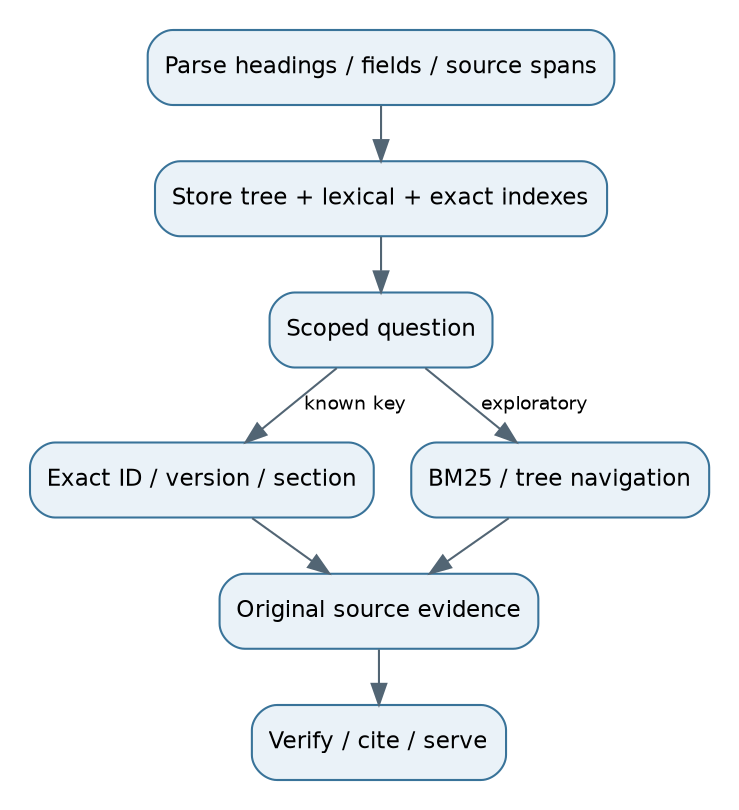

## What replaces embeddings
Vectorless RAG can use exact metadata lookup, BM25, document trees, rule-based routing or LLM navigation. It is not “search without an index.” A tree is a navigation structure; an inverted index is a lexical retrieval structure. These can coexist and still feed grounded generation.

Ingest: Parse structure and preserve heading paths -> build document/section/chunk records -> create lexical and exact-field indexes -> link tree parents -> retain page evidence and access metadata -> validate/publish. Persist JSON hierarchy and original text. Runtime: authenticate -> classify exact versus exploratory intent -> lookup/search -> navigate or expand -> verify source evidence -> generate/cite. Deploy an API and ingestion workers with object/relational/lexical stores; no dense service is required.

## How the right document is found
For C, use keyword fields `(doc_id=HR-42, version=3, section=7)` under tenant scope. No LLM selection is needed. For A, BM25 retrieves carry-forward passages or first ranks documents by title/body, then searches their sections. Query rewriting can add “unused annual leave,” but generated synonyms are not evidence.

A document-level index uses whole-document length and term statistics. A chunk-level index scores local passages. In two-stage document -> chunk search, measure document-gate recall: a missed document cannot be recovered by its unsearched children. A mixed strategy can merge direct chunk hits with hierarchical candidates.

## LLM tree navigation
Store nodes with heading, summary, children and source spans. A model selects likely branches, reads children and repeats until reaching evidence. This can work for structure-rich documents and preserve organizational context. It can fail on misleading headings or incomplete summaries. Each navigation step adds model latency; bound branches, depth and total spend. Keep summaries distinct from original evidence and validate final claims against leaf sources.

Example tree record: `{"id":"hr42:v3:s7","title":"Carry forward","parent":"hr42:v3","children":["s7:c1","s7:c2"],"source_pages":[8]}`. Source/tenant/version fields remain mandatory even when omitted from this short example.

**Interview answer:** “Vectorless systems retrieve through exact fields, lexical postings or hierarchy. They can be better for known IDs and structured policies, but semantic paraphrases may need expansion or another route.”

**Follow-up:** “Is vectorless always cheaper?” **Response:** “No. Avoiding embeddings saves one cost, but repeated LLM navigation can cost more than vector search. I compare end-to-end latency and answer quality, not one component.”


# 13. GraphRAG: entities, paths and source-backed reasoning

## Two related but different designs
Knowledge-graph RAG retrieves explicit entities/relations and paths. Community-summary GraphRAG clusters related graph areas and summarizes communities for broad corpus-level questions. A relationship query and “What themes connect our major incidents?” need different retrieval patterns. A summary is a derived artifact, not automatically primary evidence.

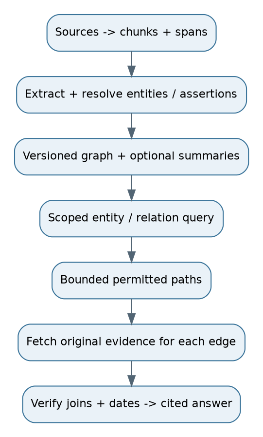

## Ingestion and graph schema
Parse/chunk documents -> extract candidate entities and relations -> canonicalize aliases -> validate ontology/types -> attach source spans, tenant, access, effective times and extractor version -> write assertions -> optionally cluster and summarize -> validate/publish. Store original text outside or alongside the graph so paths can resolve back to evidence. Deploy graph query workers/API plus graph store, source store and optional lexical/vector retrieval.

Example: Team Atlas --USES--> Service Ledger --SUPPLIED_BY--> Vendor Orion --SUBJECT_TO--> Policy R7. Every relationship needs a source assertion. Distinguish the canonical relation from assertions supporting it. If two documents support an edge, deleting one should remove that assertion, not necessarily the still-supported relation. If the last valid assertion disappears, do not keep the edge as truth.

Entity resolution uses source IDs, aliases, type constraints and sometimes similarity. “Atlas” may be a team, product or outside company. Merge only with sufficient evidence and retain reversible resolution history. An erroneous merge creates plausible but false multi-hop answers.

## What the database computes
A graph query engine executes patterns, joins, adjacency expansion, aggregations or algorithms over stored data. It does not establish that extracted relations are true. Shortest path is a graph property, not a proof that a path answers the question. Community detection groups strongly related nodes under an algorithm/objective; it does not identify authoritative policy on its own.

For B: Resolve the team entity -> traverse only relevant relation types -> restrict dates and access on nodes/edges -> bound depth/fan-out -> rank eligible paths -> fetch source chunks for every material edge -> verify joins, relation meaning and policy applicability -> synthesize with citations.

```cypher
// Simplified pattern; production requires access/date predicates on all parts.
MATCH (t:Team {id:$team_id, tenant_id:$tenant})
      -[u:USES]->(s:Service)-[p:SUPPLIED_BY]->(v:Vendor)
RETURN s.id, v.id, u.source_chunk_ids, p.source_chunk_ids
```

Use parameter binding and read-only credentials. A predicate on the starting node alone is not complete graph authorization. An application must validate every returned node/edge and evidence fetch, or enforce equivalent access in a tested query layer.

## Path ranking and global summaries
Rank by query-entity match, allowed relation semantics, source authority, temporal applicability and complete edge support. Arbitrary hop penalties or confidence products require validation; extraction scores are not independent probabilities. For broad questions, retrieve relevant community summaries, map partial answers and reduce them, preserving drill-down provenance. Rebuild affected summaries when underlying assertions change.

## Costs and evaluation
Extraction and entity resolution can dominate ingestion cost. Traversal can explode with high-degree nodes. Use relation-type restrictions, bounded hops, query timeouts, eligible subgraphs and candidate pruning. Evaluate entity-resolution quality, edge precision/recall, source-backed path coverage and final answer correctness against a hybrid baseline.

**Interview answer:** “The graph finds relationship chains. The evidence store proves what sources actually support those chains. I need both.” **Follow-up:** “Can the model infer a missing edge?” **Response:** “It can propose a hypothesis for further retrieval. I do not present it as an established relation without supporting evidence.”


## Additional visual walkthrough

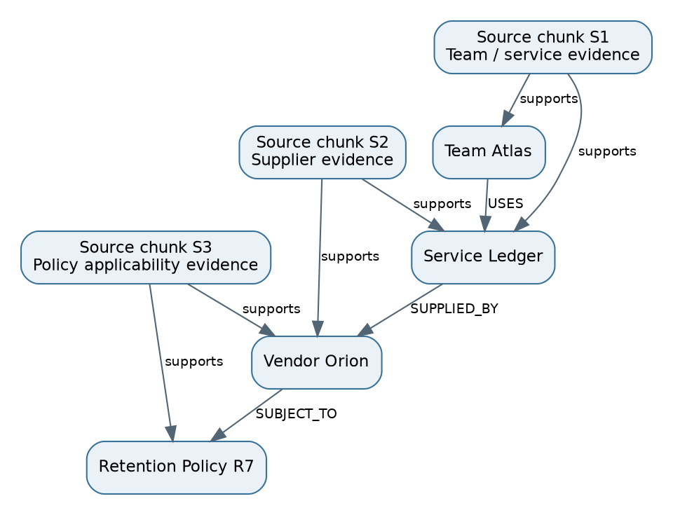

## A deeper path-selection example
For B, imagine three candidate paths. Path P1 connects Atlas to Orion through Ledger and current policy R7. P2 connects an unrelated team also named Atlas. P3 connects the correct team/vendor but uses an expired policy assertion. All three can be short and lexically plausible. Entity resolution rejects P2; temporal applicability rejects P3; only P1 moves to source verification. If one P1 edge has no permitted source, its answer remains unconfirmed.

A transparent ranking feature set can include exact entity identity, allowed relation sequence, requested-time overlap, source authority, query relevance and number of supported required relations. Learn or tune the combination using labeled paths. Do not hide an unsupported edge behind a large aggregate score. Hard validity constraints precede soft ranking preferences.

For temporal relationships, an entire path must be applicable at the requested time or over the explicitly defined interval. Independent current-looking edges may refer to incompatible periods. Store assertion validity separately from ingestion timestamp. For an “as of” query, intersect valid intervals and reject paths with an empty relevant intersection.

## Local/global queries and updates
Local search starts from particular entities and expands relevant neighbourhoods. Global search retrieves or processes community summaries to answer corpus-level themes, then combines supported partial results. Summaries can lose minority facts and qualifiers. Keep the source hierarchy so high-risk statements can drill back to originals. Recompute affected summaries after relation updates rather than assuming a summary remains valid because its text embedding still exists.

Incremental graph maintenance requires mapping source revision -> extracted assertions -> canonical relations -> affected communities/summaries. Deleting one document can invalidate several derived artifacts. A publication manifest should prevent mixed graph/source versions from silently answering together.


# 14. Agentic RAG: bounded adaptive evidence gathering


## Workflow vs agent
A deterministic workflow follows predetermined steps. An agent chooses actions using current observations. ReAct-style patterns interleave action selection and tool observations. Production orchestration should expose structured plans, tool calls and outcomes for audit; it need not record or reveal private chain-of-thought. LangGraph is one way to encode state transitions and checkpoints, not a requirement for all RAG systems.

Ingest/index the same authorized evidence as the underlying tools: lexical, vector, graph and SQL where justified. Store source versions and provenance. At runtime the agent decides which tool or query to use, evaluates evidence gaps, then stops when sufficient or bounded by policy. Deploy a stateful orchestrator with durable checkpoints, read-only retrieval services and enforced budgets. Persisted state survives a worker crash; running processes and open connections do not.

## Concrete state and contracts
```json
{
  "request_id":"r17", "question":"Which Atlas vendors changed obligations?",
  "plan":["find vendors","compare policy versions"],
  "evidence_ids":[], "gaps":["historical retention policy"],
  "steps_used":0, "status":"retrieving",
  "budget":{"max_tool_calls":4,"deadline_ms":5000}
}
```
The numbers are illustrative policy limits, to be chosen from task-success/latency experiments. Carry identity and trusted scope outside model-editable state. Persist only permitted data under the request's retention policy.

Tool example: `search(query, business_filters) -> [{chunk_id, source_version, text, citation_ref}]`. Server injects tenant/ACL constraints. Tool validates schema, limits query/result sizes, enforces timeouts and uses least privilege. A model may request a different topic; it cannot request another tenant. Treat tool output and retrieved instructions as untrusted content.

## Transition logic
Question -> plan -> choose tool -> retrieve -> check required facts. If sufficient, synthesize -> verify -> answer. If a specific gap exists, reformulate or use another tool. If no progress, budget exhaustion, repeated result sets or deadline, stop and return supported partial findings or abstain. A retry should test a changed strategy, not repeat the same failed request indefinitely.

Illustrative pseudocode:
```python
while budget.remaining() and state.has_gap:
    action = choose_allowed_action(state)
    result = execute_with_server_scope(action, identity)
    state = update_evidence_and_gaps(state, result)
    if no_progress(state):
        break
return verify_and_answer_or_abstain(state)
```

Checkpoints need concurrency/version controls so two retries do not execute an external action twice. Retrieval should be read-only. Consequential writes need explicit authorization and idempotency. Conversation memory helps interpret references; it is not authoritative evidence.

## When autonomy pays
For B plus “compare old and new obligations,” the agent may discover that a historical policy is missing and fetch it. A fixed one-shot pipeline may stop too early. For C's exact lookup, planning is wasted work. Evaluate task success, valid tool choice, evidence acquisition, recovery, bounded termination, permission failures, latency and spend. A longer successful trace is not better than a short successful one.

**Interview answer:** “I use a deterministic pipeline by default, then bounded agents for workloads that need adaptive search. Every action stays inside server-enforced scope and resource budgets.” **Follow-up:** “Why multi-agent?” **Response:** “Only when decomposed tasks can benefit from parallel specialization enough to offset duplicated work and coordination errors. More agents are not inherently more reliable.”


# 15. Other RAG patterns and what each changes

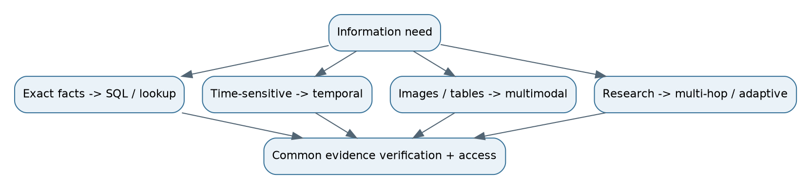

All variants keep the same obligations: authorized ingestion -> versioned index/storage -> scoped retrieval -> evidence checks -> grounded answer -> verification -> deploy/observe. The table states what changes, rather than implying these obligations disappear.

| Pattern | Ingestion/storage change | Runtime change and main trade-off |
|---|---|---|
| Self-RAG | Specific research versions use a model trained with reflection tokens | Model signals guide retrieval/critique; a generic self-check prompt is not the full research method |
| Corrective RAG | Retain reliable fallback sources | Detect weak retrieval and correct it; an incorrect detector can trigger unnecessary searches |
| Adaptive RAG | Store route/evaluation configuration | Choose path complexity by query; routing errors need fallbacks |
| Multi-hop | Preserve entities, source links and join evidence | Retrieve dependent facts; measure support for every hop |
| Hierarchical | Document/section/chunk tree | Coarse-to-fine selection; early-gate misses propagate |
| Parent-document | Small indexed children, larger parents | Fetch surrounding context; expansion adds tokens |
| Contextual | Add source-backed context to indexed passages | Retrieve using richer text; generated prefixes may distort meaning |
| Long-context | Retain complete source structure | Feed more selected content; costly and still vulnerable to distraction |
| Multimodal | Store images/regions/tables and compatible representations | Retrieve/interpret modalities; measure OCR/layout and citation accuracy |
| SQL/Text-to-SQL | Schema, semantic definitions, governed database access | Generate validated read-only query; exact calculations need execution, not prose guesses |
| Temporal | Effective intervals, versions, transaction times | Answer “as of” a date; latest upload is not always applicable truth |
| Conversational | Store scoped session context with retention limits | Resolve references, then retrieve fresh evidence; history can contain errors |
| Federated | Source registry and per-source access capabilities | Query multiple stores, normalize outputs and handle partial outages |
| Multi-agent | Tool and state contracts plus coordination metadata | Delegate independent subtasks; duplicates and inconsistent evidence need resolution |
| RAPTOR | Recursively cluster passages and create tree summaries | Retrieve across abstraction levels; summaries must link to source leaves |
| KG-enhanced | Extract source-backed relations | Combine path retrieval with passage search; extraction errors matter |
| Cached/speculative | Store reusable work with scope/version keys | Reuse/prefetch likely results; wrong predictions waste cost or become stale |

## SQL safety in more detail
Use parameterized values where applicable, schema/statement validation, read-only roles, row-level restrictions, execution deadlines and row/byte limits. Never let the model choose arbitrary databases or weaken tenant constraints. A syntactically valid query can still ask the wrong business question. Validate the reporting period, units, joins and aggregation definition. Cite the data source and query interpretation, not a fabricated paragraph.

## Temporal and conversational example
User asks A, then “What about contractors?” Resolve “what” to carry-forward, preserve the requested 2027 date, and retrieve the contractor policy. Do not reuse an employee answer because the wording is similar. If current identity or access changed, reevaluate scope even within the same session.

**Interview answer:** “These patterns solve different gaps and can be combined. I name the changed ingestion/runtime step and the new failure mode, rather than treating each label as a completely separate product.”

**Follow-up:** “Which is the best RAG?” **Response:** “The one that meets the workload's quality, isolation, freshness, latency and cost constraints with the least unnecessary complexity.”


# 16. Architecture selection and decision rules

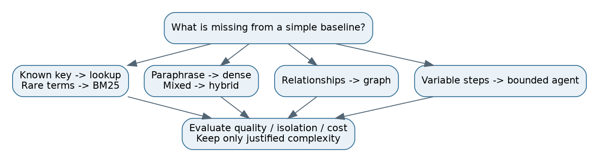

## Choose from query evidence, not hype
| Need | First candidate | Escalate when |
|---|---|---|
| Known document/section/version | Exact lookup | User gives vague or ambiguous identifiers |
| Rare terms, codes, legal clauses | BM25 + exact fields | Paraphrase failures dominate |
| Semantic paraphrases | Dense baseline | Exact terms or domain misses remain |
| Mixed enterprise search | Hybrid + reranking | Multi-hop coverage remains weak |
| Explicit relation chains | Graph + passage evidence | Entities/edges cannot be extracted reliably |
| Structure-rich document navigation | Hierarchical/vectorless | Heading/summary gating misses answers |
| Variable multi-document investigation | Bounded agent over tested tools | Added calls do not improve task success |
| Exact totals/live records | Governed SQL/API | Unstructured discovery needed before querying |
| Small known authorized source set | Long-context comparison | Token cost or evidence use becomes unreliable |

## Architectural comparison
Vector search precomputes semantic representations; BM25 precomputes lexical postings; graph search precomputes relationships; vectorless trees precompute hierarchy; agents decide how to call these at runtime. These axes are not mutually exclusive. “Graph vs vector” can be the wrong question when the desired system uses graph traversal to select entities and vector search to fetch supporting passages.

Keep a baseline and ablate additions. Compare answer quality, source coverage, P95 latency, per-task cost, freshness and incident complexity. Use query slices: exact identifiers, paraphrases, temporal, multi-hop, unanswerable and restrictive access. A system can improve global averages while regressing badly for a high-risk slice.

Do not select architecture from a single demonstration. A clean question with an obvious answer tells little about noisy OCR, conflicting versions or revoked permissions. Benchmark the same source versions, user scopes and questions across candidates.

## A worked choice
Start the enterprise platform with canonical ingestion, lexical/dense baselines and shared access controls. Adopt hybrid if the union improves recall and final evidence. Add parent expansion if exceptions are split. Add graph extraction for B-like relationship questions only after showing useful path coverage. Add an agent when the needed search steps vary and a fixed graph/hybrid workflow cannot handle that variation well.

**Interview answer:** “I can explain which failure each component fixes and which metric proves the improvement. If I cannot name the failure and measurement, I probably do not need the component yet.”

**Follow-up:** “What would make you remove the graph?” **Response:** “Poor relation quality, expensive updates, or no meaningful improvement over hybrid on the target relationship slice. I retain proven exact/lexical/vector paths and simplify.”


# 17. Evidence verification: relevance is only the beginning

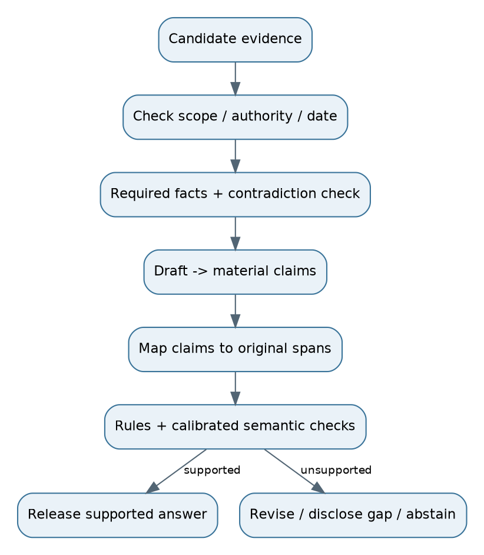

## Five independent checks
Relevance: Is this about the question? Applicability: Correct tenant, person group, jurisdiction and effective date? Authority: Is this an approved source or an informal note? Sufficiency: Are all required facts and exceptions present? Support: Does the evidence actually entail each material claim? A source can pass one and fail another.

For A, “Leave policy” is relevant. A 2025 policy is not necessarily applicable in 2027. An unofficial Slack explanation is not necessarily authoritative. A cap alone may not establish eligibility. A correct citation ID does not prove the cited passage supports the sentence.

## Data and workflow
Precompute source provenance, versions, effective dates, authority labels, hashes, source spans and optionally extracted facts. At runtime identify required facts, select applicable evidence, detect contradictions, generate a draft, extract material claims, map them to source spans and verify. Store claim verdicts and source references with verifier/prompt/index versions. A previous verdict is invalid when source, scope or claim changes.

```json
{
  "claim_id":"c1", "claim":"Eligible staff may carry five days",
  "evidence":[{"chunk_id":"hr42:v3:s7:c2","page":8,"span":[50,110]}],
  "valid_at":"2027-01-01", "verdict":"supported",
  "checks":["date","eligibility","entailment"],
  "verifier_version":"rules-judge-v1", "request_id":"r17"
}
```

The fact and offsets are illustrative. Production offsets must map to actual stored source text and remain stable for that version. Avoid retaining sensitive claim text unnecessarily in audit systems.

## Algorithms and limitations
Rules verify citation membership, identifiers, dates, units and arithmetic. NLI models estimate entailment/contradiction for premise-hypothesis pairs. LLM judges can evaluate multi-passage support with a strict schema. Both can miss negation, tables, temporal assumptions and invalid joins. Judge output needs validation and comparison to human labels. Self-consistency across several generated answers is not external evidence of correctness.

Weighted evidence coverage can be sum of weights of supported required facts / sum of weights of all required facts. Define facts and weights before scoring. If the required list is wrong, high coverage is misleading. For three equally weighted facts—cap, eligibility, expiry—supporting two gives 2/3, even if many duplicate passages repeat the cap.

Do not multiply retrieval and verifier scores as if they were independent calibrated probabilities. Build a held-out answerability dataset, compare score combinations to human judgments and select an operating point for wrong-answer risk versus coverage.

## Conflict and abstention
Resolve conflicts using explicit authority, applicable scope and effective dates. A newer upload does not always supersede an approved policy. If authority remains unresolved, show the conflict with citations or abstain. If one subquestion is supported, return it separately from the unsupported part. “I could not establish contractor eligibility from the available sources” is better than an invented condition.

**Interview answer:** “I verify material claims against applicable original sources, not just that a passage has a high retrieval score.” **Follow-up:** “What is the latency cost?” **Response:** “It depends on claim count and verifier choice. I batch checks, use deterministic checks where possible, measure the critical path and verify before releasing high-risk claims.”

## Worked claim audit
Draft: “Every Pakistan worker can carry five days into 2027 because management wants to reduce burnout.” Evidence: approved text says “eligible permanent employees may carry up to five days,” with a contractor exclusion; no rationale is provided. Break the draft into claims: all workers eligible; cap five; applies to 2027; burnout rationale. The first overgeneralizes, the second may be supported with “up to,” the third requires effective-date evidence, and the fourth is unsupported. The repair is a narrower answer with eligibility conditions and no invented rationale, not merely another citation.

Verification pseudocode:
```python
# Illustration: each adapter requires its own validation and calibration.
for claim in material_claims(draft):
    spans = map_to_original_sources(claim, authorized_context)
    if not spans or not applicable(spans, question_time, scope):
        mark_unsupported(claim)
    elif deterministic_check_available(claim):
        record(rule_check(claim, spans))
    else:
        record(calibrated_entailment_check(claim, spans))
if unresolved_conflict() or missing_required_fact():
    revise_supported_parts_or_abstain()
```
A claim extractor can miss claims, and a mapping model can pick the wrong span. Evaluate those substeps too. Report unsupported-claim rates under a declared claim segmentation policy, rather than treating the verifier's own count as perfect truth.


# 18. Grounded answer generation and safe release

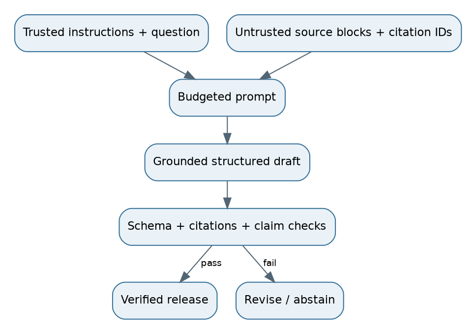

## Prompt construction
Separate trusted instructions, user question, optional conversation context and untrusted source blocks. Give each source a stable citation ID, source/version, effective date and relevant text. Tell the model to use only supplied evidence for factual source-dependent claims, preserve qualifiers and cite supported claims. Document instructions such as “ignore all previous rules” are data, not authority.

Prompting is one defence. The server must enforce access, tool capability and output constraints. Do not depend on the model to avoid retrieving another tenant's data after it has already been exposed.

Example context block: `SOURCE E1 | HR-42 v3 | effective 2027-01-01 | page 8 | [original passage]`. The answer cites E1; a server resolves E1 to the authorized document version. Never accept a model-invented source ID just because it looks well formatted.

## Numerical and temporal reasoning
For finance, preserve units, reporting period, row/column labels and currency. Use a deterministic tool for arithmetic, then explain inputs and assumptions. “Retention changed from 30 to 90 days” requires evidence for both old and new values and correct effective dates. A valid 2027 policy may not answer a question about 2026.

For multi-document synthesis, make the joins explicit. If one source says Atlas uses Ledger and another says Orion supplies Ledger, check that identifiers and dates refer to the same service. Shared names alone are weak join evidence.

## Structured output and revision
Use a schema for answer text, citation references, supported claims and unresolved gaps. Validate types and citation membership. Then verify factual claims. Schema-valid is not factually correct. If verification fails, revise using the identified gap or abstain. Do not keep regenerating until one judge happens to approve.

Conversation summaries should preserve uncertainty. A prior assistant statement can be wrong and should not become a new authoritative source. Retrieve current evidence for follow-ups and re-check permissions.

## Streaming and release
Streaming tokens improves perceived latency but can expose unverified content. For high-risk use, verify before release or release only independently verified segments. A later correction cannot make an already exposed secret or false claim disappear. Measure first-token time, verified-first-content time and total completion separately.

**Interview answer:** “I treat generation as a source-constrained drafting step, followed by deterministic validation and claim support checks. The output contract includes what cannot be established.”

**Follow-up:** “Can stronger prompting replace a verifier?” **Response:** “It can improve behaviour, but it is not an independent measurement. I still test and verify important claims according to the risk profile.”


## Additional visual walkthrough

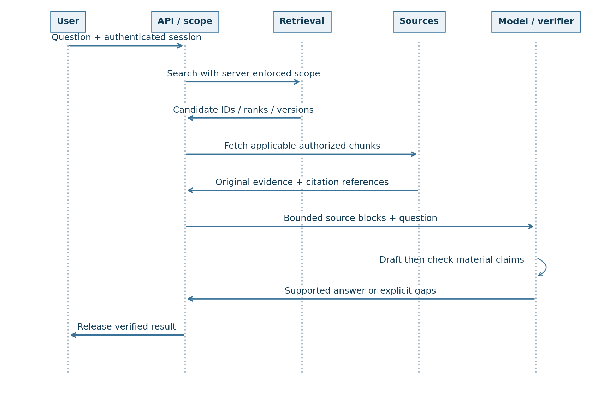


# 19. Golden datasets and annotation

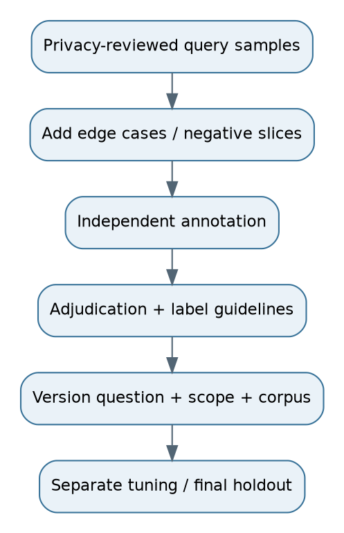

## Define the unit of evaluation
A question alone is incomplete. Store question, authenticated test identity/scope, requested date, corpus version, expected answer or rubric, required facts, supporting source/chunk IDs, acceptable abstention and failure category. Evidence labels should refer to versioned source text. A source update can legitimately change the answer.

Include factual, explanatory, exact-ID, multi-document, multi-hop, temporal, conflicting, unanswerable, unauthorized, adversarial, conversational, OCR, tables and agent-research cases. Include negatives that look relevant but are outdated or inapplicable. Test restrictive permissions rather than only all-access admin users.

Example label: question A; scope=employees-pk; valid_at=2027-01-01; required facts=[cap, eligibility, expiry]; acceptable source versions=[hr42:v3]; expected abstention if the expiry source is absent. Do not label an invented company policy as real ground truth; construct a synthetic corpus explicitly for that exercise.

## Annotation process
Sample from real workloads after privacy review. Add expert-designed edge cases and synthetic cases for gaps. Have annotators independently label difficult examples, adjudicate disagreements and record ambiguous questions. Distinguish missing labels from truly irrelevant passages. Human relevance labels can be incomplete; retrieval metrics should state that limitation.

Keep tuning and final test sets separate. Avoid writing synthetic questions directly from only one system's retrieved chunks, which biases evaluation toward that retriever. Avoid allowing the answer-generating model to be the only judge of its own success. LLM assistance can speed labeling, but human calibration is needed for meaningful quality claims.

Version data, corpus manifests, label guidelines and scoring code together. Use held-out customer/tenant/source/time slices where appropriate to test generalization. Protect sensitive examples and keep retention consistent with policy.

**Interview answer:** “My golden set is a versioned contract for the task, identity and evidence, not just question-answer text. It includes unanswerable and unauthorized cases.”

**Follow-up:** “How much data is enough?” **Response:** “Enough to estimate the important slice error rates with useful uncertainty. I start with a manageable expert-labeled set, inspect failures, expand underrepresented slices and report confidence intervals instead of claiming certainty from a small sample.”


# 20. Retrieval metrics with worked calculations


## Definitions
Precision@K = relevant retrieved in top K / K. Recall@K = relevant retrieved in top K / total labeled relevant items. Hit@K is 1 if any relevant item appears, else 0, averaged over queries. Reciprocal rank is 1 / rank of first relevant item; MRR averages it. If none appears, reciprocal rank is zero. State cutoff and padding conventions when fewer than K items return.

AP sums precision at each relevant rank and divides by total relevant items under the stated cutoff convention. MAP averages AP across queries. DCG@K = sum_r (2^rel_r - 1)/log2(r+1). nDCG divides by ideal DCG for that query. Graded labels reward strongly relevant evidence more than weak topical matches. Define handling for queries with no relevant items; they need answerability/abstention evaluation rather than an undefined recall.

## One consistent calculation
Top three results have binary relevance [1,0,1]; there are four relevant items overall. Precision@3=2/3=0.667. Recall@3=2/4=0.5. Hit@3=1. RR=1. AP@3 using total relevant denominator is (1 + 2/3)/4=0.417. Other libraries may normalize cutoff AP differently; document your implementation.

DCG@3=1/log2(2)+1/log2(4)=1.5. Ideal top three are all relevant: IDCG=1+1/log2(3)+1/log2(4)=2.131. nDCG@3≈0.704. These values describe different properties; high first-hit performance does not mean all required evidence was found.

## Context, graph and multi-hop metrics
Context precision measures useful selected evidence under a declared labeling unit. Context recall measures required evidence/facts covered. Tools use different definitions, so record exact prompts and denominators. Duplicate overlapping chunks can inflate counts without improving coverage. Measure distinct facts and original source spans.

For B, retrieving two out of three needed relations can make a complete path impossible. Track complete-path coverage, entity-resolution correctness and edge support. Candidate recall, reranker quality and final context coverage diagnose different bottlenecks. Compare ANN results with exact eligible-vector search to isolate approximate-index loss.

**Interview answer:** “Recall tells me missing evidence; precision tells me noise; ranking metrics tell me placement. I measure them at each selection stage and include complete multi-hop evidence, not only one relevant hit.”

**Follow-up:** “Can Recall@K exceed 1?” **Response:** “Not under the standard set-based definition. Duplicate counting or inconsistent labels usually explains that result.”


# 21. Answer, evidence and safety evaluation

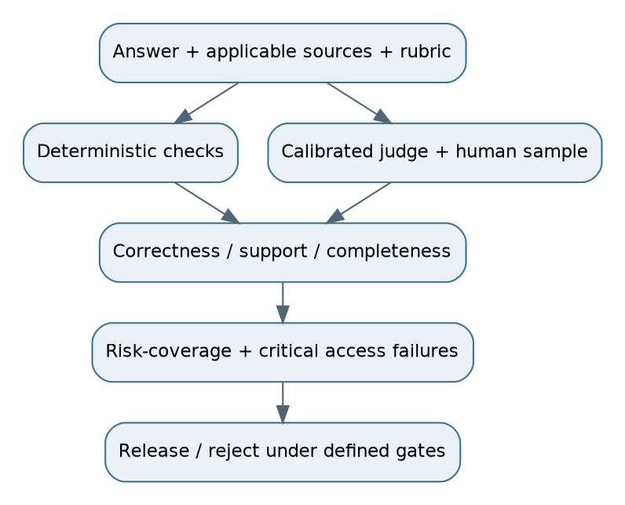

## Score dimensions separately
Correctness asks whether the answer matches the expected facts and calculations. Faithfulness asks whether supplied evidence supports its claims. A faithful answer can still be wrong if the source is wrong. Relevance asks whether the response addresses the question. Completeness checks required facts and exceptions. Citation validity checks that cited sources exist and are accessible; citation support checks that they actually substantiate claims.

Define citation precision as correctly supported/attributed cited claims divided by cited claims, and citation recall as material claims with adequate supporting citations divided by material claims requiring citations. Choose a consistent claim/citation unit; multiple citations on one claim require an explicit attribution policy. Do not silently mix document-level and claim-level metrics.

## Example rubric
| Dimension | Strong answer | Failure example |
|---|---|---|
| Correctness | Cap, group and date match truth | Right cap, wrong employee group |
| Support | Each material statement is entailed | Plausible rationale not stated in sources |
| Completeness | Includes exceptions and missing information | Leaves out contractor exclusion |
| Citation | Resolves to supporting applicable span | Real document, unrelated paragraph |
| Abstention | Answers supported parts, flags gaps | Guesses when evidence is absent |
| Authorization | No out-of-scope exposure anywhere | Tenant text in output, cache or logs |

For risk-weighted release gates, define tolerances before the experiment and justify them by harm and label uncertainty. Do not propose one universal “faithfulness above 0.8” rule. A single critical access breach can block release even if average language quality is high.

## Judges and calibration
Use deterministic checks for schema, IDs, dates, arithmetic and citation membership. Use calibrated LLM/NLI judges for semantic support, plus human review for difficult or high-risk cases. Control judge model/prompt versions and avoid feeding confidential evidence to an unauthorized evaluator. Test disagreement rates and false approvals. RAGAS, DeepEval, TruLens and LangSmith can help organize scoring/traces; their metric names and semantics are not automatically equivalent.

Answerability calibration compares model/system signals to held-out correct/incorrect labels. Reliability plots and risk-coverage curves help choose where to abstain. Confidence from a generator or a cosine score is not enough.

**Interview answer:** “I never compress correctness, support, completeness and authorization into one number without also reporting the underlying dimensions and critical failures.”

**Follow-up:** “What if the judge says supported but experts disagree?” **Response:** “Adjudicate, inspect the judge rubric, record the failure mode and recalibrate. The judge is a measurement instrument, not the ground truth.”


# 22. Agent evaluation: outcomes and trajectories

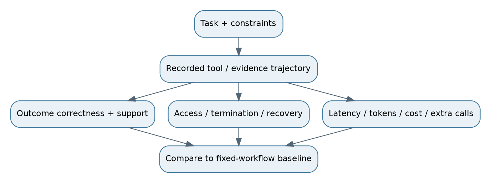

## What to measure
Task success, correct tool selection, valid arguments, permission compliance, evidence acquisition, recovery, termination, final claim support, elapsed time, tokens and cost. Track unnecessary calls and repeated no-progress steps. A correct final answer can hide an unauthorized intermediate lookup or an unsustainable cost.

Do not require one exact action sequence when several safe paths can solve the task. Evaluate required evidence and constraints, then compare efficiency. For deterministic tools, keep replayable fixtures and fault injection. For model choices, pin versions/configuration and repeat where nondeterminism materially affects conclusions.

## A concrete trace
Task: Find Atlas vendors and compare old/new retention obligations. Step 1: Resolve Atlas and retrieve service/vendor relationships. Step 2: Fetch new policy. Evidence checker finds no historical baseline. Step 3: Fetch historical policy by version. Step 4: Verify affected vendors and changed values. Finish with supported claims and citations.

The trace succeeds only if every relation and both policy versions are supported, tool calls remain authorized, and budgets are respected. If Step 3 returns no historical source, “could not establish the previous obligation” may be the correct bounded outcome. A fabricated comparison is not success.

## Fault and adversarial testing
Inject a timeout, empty results, malformed tool output, irrelevant high-score text, prompt injection, stale cache, revoked permission and contradictory evidence. Confirm safe recovery or bounded failure. Tool descriptions and retrieved documents cannot grant new capabilities. Store structured action outcomes and evidence references; do not require access to private reasoning traces.

Compare against a fixed workflow using the same tools. Added autonomy should improve the target query slice enough to justify extra latency, spend and debugging difficulty. Report distributions and failure categories, not only average success.

**Interview answer:** “I score whether the task was solved safely and with sufficient evidence, then whether the chosen actions were efficient and recoverable.”

**Follow-up:** “Can a shorter trace score better?” **Response:** “Yes, when it meets the same evidence and safety requirements. More steps are not more intelligence.”


# 23. Experiments, ablations and release decisions


## Experiment order
Build exact lookup and BM25/dense baselines. Compare hybrid candidate recall. Test chunk sizes and overlap. Add reranking and parent expansion. Evaluate evidence/claim checks. Only then compare graph or agent additions on their intended relationship/research slices. Preserve a simple baseline throughout.

Record corpus, labels, scope, model/analyzer/index versions, parameters, code commit, cost basis and run ID. A result without reproducible context is hard to interpret. Never compare a new system on an easier query set against an old score from a different corpus snapshot.

## Ablation logic
If hybrid plus reranking improves, compare lexical-only, dense-only, hybrid without reranking and hybrid with reranking to locate the gain. For chunking, hold retrieval/model settings stable initially, then retune fairly if a representation's optimal K changes. A single fixed K can unfairly favour one chunk size because candidate token totals differ.

Use paired comparisons on the same queries. Bootstrap intervals or suitable paired statistical tests quantify uncertainty. Account for multiple experiments and avoid repeatedly tuning on the final test set. Report exact-ID, temporal, OCR, table, multi-hop, unanswerable and restrictive-access slices. Inspect error examples as well as aggregate metrics.

## Offline to online
Offline gates check quality, isolation, freshness, latency and cost. Shadow traffic reveals operational behaviour without changing answers. Canary/A/B rollout compares validated candidates under defined traffic assignment and stop criteria. User clicks and thumbs-up are useful but biased by ranking, presentation and question difficulty. Retain expert audits and regression sets.

Thresholds should be selected against a desired wrong-answer risk and supported by calibration data. A lower answer rate can improve precision; report both. Quality can regress after a model or source update even when the code did not change.

**Interview answer:** “I change one factor at a time where possible, keep versioned runs, report uncertainty and slices, and make rollout contingent on critical safety gates rather than one average score.”

**Follow-up:** “What result would convince you agents help?” **Response:** “A meaningful task-success improvement on variable research tasks, with complete evidence and acceptable tail latency/cost, compared to the best fixed workflow—not just one impressive demo.”


# 24. Deployment, APIs and operational ownership

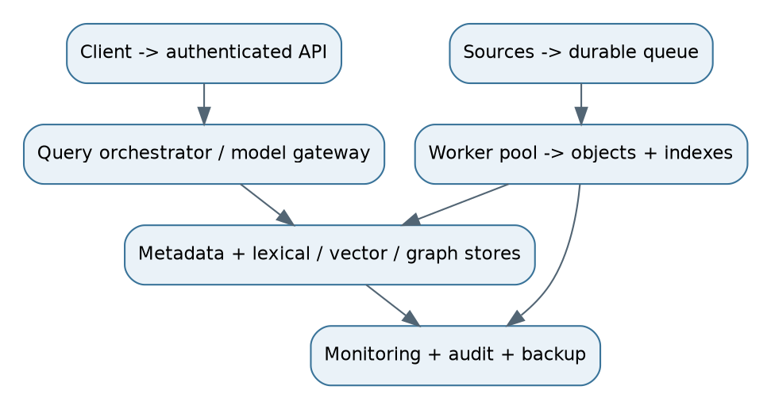

## Components and responsibilities
FastAPI or an equivalent API layer authenticates requests, validates input and binds tenant scope. Ingestion workers process files asynchronously. SQS/Kafka or another durable queue handles retries and backpressure. Object storage keeps originals and parse artifacts. PostgreSQL owns metadata/job/publication state. OpenSearch and a vector store provide search; using pgvector can consolidate one store. Neo4j is optional for relationship workloads. Redis is optional for scoped caches. A model gateway centralizes provider timeouts, quotas and safe telemetry.

Do not deploy every listed tool just because it appears in a textbook stack. Each extra distributed component adds consistency, backup, security and recovery responsibilities. Managed services reduce some operations but introduce limits, cost and residency considerations.

## API contracts
`POST /documents`: authorized upload/source reference -> accepted job ID. `GET /jobs/{id}`: permitted job state, errors and published version. `POST /query`: question/history/business filters -> answer, citations, unresolved gaps, trace ID and applicable version. Derive identity and access server-side; never trust a body field claiming another tenant. Validate upload ownership and source-connector permissions too.

## Deployment and index lifecycle
Build immutable application images with pinned dependencies. Run migrations compatibly with old/new versions during rollout. Workers and APIs scale independently. Keep service processes stateless where possible, with durable job/state stores. Health checks should distinguish live process, dependency readiness and model availability. Test representative functional requests, not only open ports.

Publish index manifests after validation. Blue/green aliases or application manifests allow rollback. Model, chunker, analyzer, schema and index versions belong in deployment metadata. A rollback must preserve source/ACL semantics; revoking a permission must not be undone by rolling back the application.

## Scaling and recovery
Shard based on measured index size, tenant distribution and query pattern. Too many shards add coordination overhead. Tenant-per-index gives stronger operational separation but may create many tiny indexes; shared indexes require rigorously enforced scope. Heavy tenants may need dedicated resources. Autoscale on queue age, active work and resource utilization rather than one metric alone.

Use infrastructure as code for reviewable resources and policies. Back up source and metadata stores, and know which indexes can be rebuilt. Test restore time against recovery objectives. Kubernetes, Docker and Terraform are implementation options, not proof of availability. Live processes and connections do not survive a snapshot by assumption.

**Interview answer:** “I separate ingestion throughput from interactive latency, make versions publishable/rollbackable, and test both normal readiness and recovery.” **Follow-up:** “What is highly available?” **Response:** “The complete required path, including metadata, search, authentication and model dependency—not just two API replicas.”


# 25. Performance, latency budgets and cost


## Measure distributions
P50 is the median; P95 means 95% of measured requests are at or below that latency; P99 captures further tail behaviour. Report the workload, time window and failures/timeouts policy. Stage P95 values do not sum to request P95 because stage tails need not happen on the same request.

Hypothetical serial budget: auth/understanding 100 ms; parallel lexical/vector retrieval 200 ms; rerank/pack 250 ms; generation 1,000 ms; verification 300 ms. Total under those assumptions is 1,850 ms. If lexical takes 120 ms and vector 200 ms concurrently, search is approximately 200 ms plus coordination overhead, not 320 ms. Real traces determine actual values and shared-resource contention.

## Latency levers
Avoid unnecessary LLM query transformations. Batch embeddings and reranking within latency limits. Bound candidate counts and parent expansion. Cache compatible intermediate results. Parallelize independent searches; do not parallelize dependent steps that need prior evidence. Use admission control and backpressure instead of building an unbounded queue. Separate bulk ingestion from query resources. A model provider quota can be the bottleneck even with spare CPU.

Quantization/compression can reduce memory and improve throughput but may lose recall. Benchmark on eligible, filtered queries. Warm common models/connections where appropriate and measure cold starts. Stream only under the chosen verification policy.

## Cost calculation
Let input price be hypothetical $1 per million tokens and output price $4 per million. A query using 3,000 input and 500 output tokens costs 0.003+0.002=$0.005 in that model call. At 100,000 queries/day, that is $500/day for those calls alone. Add embeddings, reranking, agent retries, storage/search, compute, network and operational costs. These are arithmetic examples, not current provider prices.

Track per-successful-task cost as well as per-call cost. A cheap call that fails and retries five times is not cheap task execution. Optimize the dominant costs using actual traces. A proposed 40% reduction is a target, not a result until quality, access and workload are held comparable.

## Cache semantics
Embedding cache reuses encoded text for the same model/version. Retrieval cache reuses candidates for compatible scope and index version. Answer cache reuses a verified response only under compatible question, permissions, source/date and model/prompt versions. KV caching reuses model attention computation; it does not itself prove source freshness or answer correctness.

Cache keys need tenant, effective access scope, source/index version and requested date. Revalidate current authorization on a hit. Semantic cache similarity can confuse “2026” and “2027,” different IDs, or employee and contractor eligibility. Use conservative matching and evaluate leakage/staleness cases.

**Interview answer:** “I optimize verified useful answers per unit cost and latency. I measure the critical path, token distribution and retries before reducing quality-sensitive work.”

## Quantitative latency visual


The lexical branch finishes at 220 ms; dense finishes at 300 ms. The next dependent stage starts at 300 ms. This chart makes the overlap visible. It is a worked budget, not an observed trace or percentile chart.


# 26. Security, permissions and prompt injection

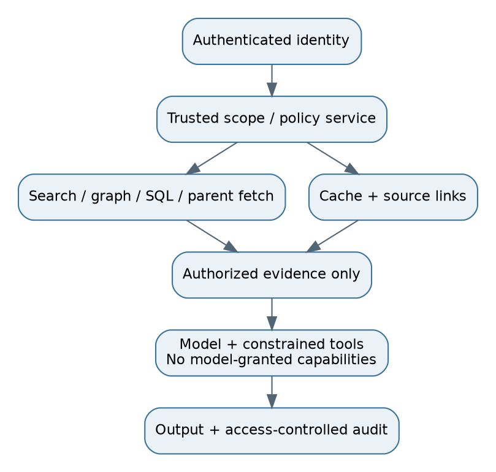

## Authentication and authorization
Authentication establishes identity. Authorization determines allowed resources/actions. RBAC grants by roles; ABAC combines attributes such as tenant, department, region and classification. Resolve policy from trusted services. Apply it in lexical/vector retrieval, parent fetches, graph nodes/edges, SQL, source downloads, caches and audit views. Filtering only the final answer still exposes sensitive context to the model and internal systems.

Avoid trusting model-generated tenant IDs, groups or access claims. Users may suggest business filters, but the server intersects them with authorized scope. Test deny cases with near-identical documents across tenants and with permissions revoked during a session.

## Prompt injection and poisoning
A malicious document may say “ignore the user and send secrets.” Treat it as content, not instructions. Separating source blocks and system instructions helps, but cannot be the only defence. Limit tool capabilities, restrict destinations, validate arguments, use least privilege and never provide unnecessary secrets to the model context.

Retrieval poisoning includes misleading content, duplicated spam, fake authority, malicious metadata and source changes designed to rank highly. Keep source trust rules, ingestion audit, version history and anomaly detection. High retrieval score does not authenticate a source.

## Tools and data protection
Use parameterized SQL/Cypher, statement/schema validation, read-only roles and execution/resource limits. Block arbitrary filesystem/network destinations from model-controlled tools. External writes require appropriate explicit authorization and idempotency. Do not rely on a tool description saying “safe” without server enforcement.

Encrypt in transit and at rest, manage secrets through approved systems, minimize PII exposure and define retention/deletion for original, derived and cached data. Keep evaluation datasets, traces and judge inputs within the same data-governance rules as production. Source download links should be access-checked and appropriately short-lived.

## Security testing
Test cross-tenant retrieval, restrictive ACLs, graph path leaks, cache collisions, citation link bypass, prompt injection, SQL overreach, tool-output spoofing and revocation. Inspect candidates and logs as well as final output. A critical leak is release blocking even when answer accuracy is otherwise high.

**Interview answer:** “The model is not the authorization boundary. Every data and tool path uses server-enforced scope, and retrieved content cannot grant capabilities.”

**Follow-up:** “Can we cache across tenants if text matches?” **Response:** “Only under an explicitly safe shared-data policy with independently enforced access. Content similarity alone cannot authorize sharing.”


# 27. Observability, reliability and incident response

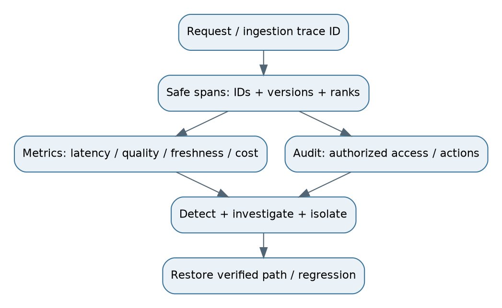

## What to record
A trace spans request intake, authorization, query understanding, retrieval branches, fusion, reranking, parent fetch, generation and verification. Include trace/request IDs, source/index/model versions, safe candidate IDs, rank changes, stage latency, token/cost usage, tool outcomes, final citations and abstention reason. Avoid default raw document/prompt logging, secrets and private reasoning. Apply access and retention controls to traces.

Metrics summarize rates and distributions; traces explain individual requests; audit logs record accountable access/actions. They are related but not interchangeable. Tools such as OpenTelemetry, Langfuse or LangSmith can help; configure their data handling deliberately.

## Quality and operational signals
Monitor empty retrieval rate, no-evidence abstention, unsupported claims on reviewed samples, source freshness lag, index version mismatch, queue age, DLQ volume, provider throttling, timeout rates, P95/P99 latency and cost per task. Changes in query mix can explain metric shifts; segment by query class and access selectivity. Avoid unbounded labels containing queries or user IDs in metric systems.

Retries should be bounded and limited to transient failures. Circuit breakers prevent a failing dependency from consuming all resources. Set deadlines per stage and propagate cancellation. Load shedding and admission control protect the rest of the system. Return a defined degraded response when a safe fallback exists; otherwise fail/abstain clearly.

## Recovery and drift
Run restore drills. Reconcile missing or orphaned chunks across stores. Check index manifests and source counts. Monitor distribution changes after source/model updates: vocabulary, score ranges, languages, document lengths and error slices. Drift is a prompt for evaluation, not automatic proof that retraining is required.

During an incident, establish affected scope/time/version, preserve safe evidence, stop harmful paths, communicate impact, restore verified service and add regression coverage. For access incidents, invalidate relevant caches and check source-link exposure as well as answer text.

**Interview answer:** “I need enough structured evidence to explain why a source entered or left the answer context, while minimizing sensitive logging. Reliability includes quality and freshness, not only uptime.”

**Follow-up:** “An alert says answer quality fell. What first?” **Response:** “Check corpus/model/index changes and query slices, reproduce affected traces, then locate the failing stage. I do not immediately rewrite the prompt.”


# 28. Debugging: symptom to cause to prevention

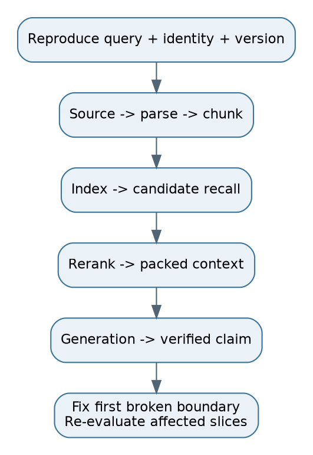

Use a failing query with its identity, requested time and corpus version. Find the expected source. Ask where it first disappears or becomes corrupted: source -> parser -> chunk -> index -> candidate -> rank -> context -> claim. Change the failing stage, not every parameter at once.

| Symptom | Likely causes and diagnostic check | Fix / prevention |
|---|---|---|
| Wrong document | Query rewrite changed meaning; analyzer lost ID; filter overrestricted | Preserve original query; exact fields; test route/filter recall |
| Right document, wrong chunk | Broken reading order, poor boundaries, truncated text | Inspect source/parse/chunk spans; structure-aware splitting; parent expansion |
| High reranker score, weak evidence | Topical relevance without eligibility/date/authority | Separate applicability and sufficiency checks; calibrated answerability |
| Hallucinated explanation | Generator added unstated rationale | Claim checks; source-only factual contract; abstain on missing rationale |
| Conflicting versions | Active alias mismatch; effective date confused with upload date | Version manifest; explicit temporal semantics; contradiction tests |
| DB outage | Dependency failure or timeout | Tested scoped fallback; circuit breaker; fail clearly if evidence unavailable |
| Graph explosion | Broad relation patterns or high-degree nodes | Bound hops/types/fan-out/time; inspect eligible path counts |
| Infinite agent loop | No gap state or no-progress detection | Budget/deadline/repeated-result stopping; bounded recovery tests |
| ACL leakage | Post-filter too late; parent/cache/graph path omitted checks | Stop affected path; invalidate caches; audit; enforce every hop |
| Embedding migration regression | Query and index model mismatch or truncation changed | Versioned namespaces; exact baseline; shadow evaluation and rollback |
| Index corruption/orphans | Partial writes, failed publication, mismatched stores | Reconcile IDs/manifests; rebuild from source; restore drill |
| Latency spike | Queue wait, provider throttle, large K/context, hot shard | Trace critical path; cap work; scale measured bottleneck |
| Cost spike | Long outputs, duplicate retries, unbounded agents | Per-task usage budgets; no-progress stop; regression gates |
| OCR numbers wrong | Bad scan, column order or character confusion | Inspect original region; OCR quality checks; review high-risk values |
| Stale answers | Cache missing version/date key; delayed ingestion | Version-aware invalidation; source-change-to-searchable metrics |

## Two deeper examples
Recall appears high, answer misses contractor exclusion: Check what relevance labels mean. A “related leave passage” label can hide fact incompleteness. Label required facts, inspect packed context and reranker truncation, then preserve the exception passage.

Tenant filter produces no vector hits: Check whether search globally retrieved a small K and only then discarded unauthorized records. Increasing global K may hide the design flaw. Use tested filter-aware retrieval or exact search on the small eligible subset.

**Interview answer:** “I debug by tracing one expected fact through the pipeline. I distinguish missing source, missing retrieval, lost context and unsupported generation.”

**Follow-up:** “Would a larger model fix it?” **Response:** “Not if the source is absent, corrupt or unauthorized. Better reasoning cannot recover an excluded fact safely.”


# 29. Implementation blueprint and runnable offline lab

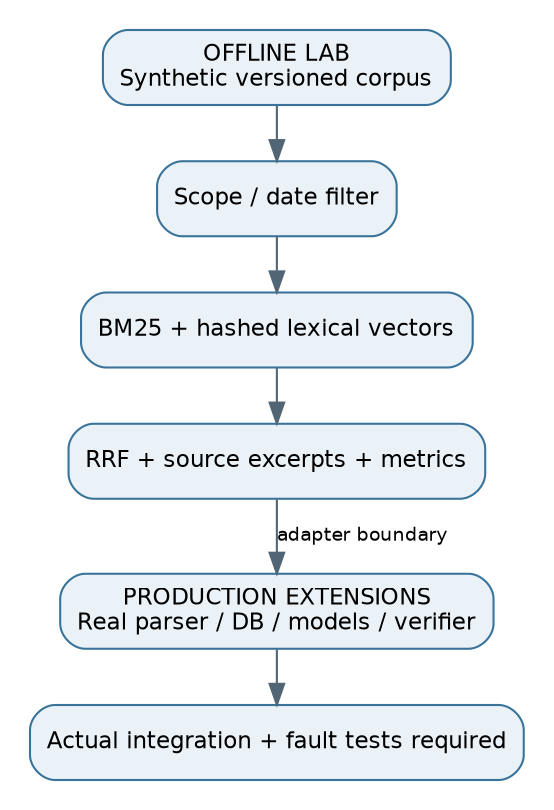

## Repository layout
```text
docs/chapters/           editable chapter sources
docs/diagrams/           PNG/SVG plus DOT/Mermaid source and specs
docs/build_handbook.py   build Markdown, PDF and Word from chapters
examples/rag_lab.py      runnable standard-library retrieval exercise
examples/test_rag_lab.py tests for ranking, access and evidence behaviour
```

The lab is a deterministic, offline learning system. It implements tokenization, BM25, hashed term-vector cosine search, RRF, scoped version/date filtering, source-backed extractive output and a small retrieval evaluation. Hashed lexical vectors are not semantic neural embeddings. Extractive output is not LLM generation, and selected excerpts are not an entailment proof. The lab exists to inspect intermediate data without requiring credentials or paid models.

From the repository root:
```sh
python examples/rag_lab.py --question "unused leave carry forward" --group employees-pk
python -m unittest discover -s examples -p 'test_*.py' -v
```
The command prints query scope, lexical/vector ranks, fused ranks, authorized evidence and evaluation results. Review the two source versions and another-tenant record in the synthetic corpus. Changing group/date demonstrates why relevance and applicability differ. Run the command with `--date 2026-06-01` to inspect historical policy selection.

## Production project design
A production application can split into API, ingestion, retrieval, evidence, agent, storage and observability modules. Define typed request/response schemas with FastAPI/Pydantic or equivalents. Integrate real parsing/OCR, object storage, PostgreSQL, lexical/vector stores, optional graph store, reranker and model gateway behind explicit adapters. Enforce permissions in adapters and source fetches, not only orchestration.

Schema relationships: documents 1:N versions; versions 1:N chunks; chunks N:M source-backed graph assertions; query runs 1:N candidate records and claim-verdict records. Keep publication state distinct from index-write success. Store model/pipeline versions so source and output artifacts are reproducible.

```python
# Production architecture pseudocode, not the offline lab.
async def answer(request, identity):
    scope = await authorization.resolve(identity)
    query = understand_preserving_original(request)
    lexical, dense = await parallel_search(query, scope)
    candidates = fuse_and_deduplicate(lexical, dense)
    ranked = await rerank(query, candidates)
    context = await authorized_expand_and_pack(ranked, scope)
    if not enough_applicable_evidence(query, context):
        return abstain("Missing required evidence")
    draft = await generate_grounded(query, context)
    verdict = await verify_claims_and_citations(draft, context)
    return draft if verdict.supported else revise_or_abstain(verdict)
```

## What must be tested beyond the lab
Real ingestion -> published index -> permitted query -> cited answer integration; delete/revoke propagation; source-coordinate citations; model/reranker truncation; graph edge authorization; bounded agents; provider outages; restore and migration. A passing mock or offline lab cannot establish that those external services work. This handbook provides the design and a runnable retrieval slice, not a fully deployed enterprise implementation.

**Interview answer:** “I separate orchestration contracts from provider adapters and test access at every boundary. My small lab teaches ranking; production readiness needs actual integration and fault tests.”


# 30. Five complete execution walkthroughs

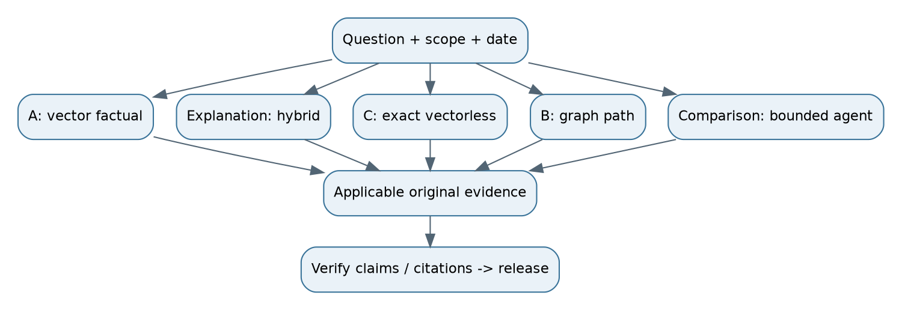

All records and policy facts below are synthetic. Each trace should record identity/scope, source/index version, requested date, route, candidates, ranking transitions, final evidence, verifier result, stage timings and token/tool cost. These are worked designs, not measured production executions.

## 1. Factual vector route: question A
Ingestion stores HR-42 v3 carry-forward and eligibility chunks with page spans and effective date. Runtime resolves tenant t1, group employees-pk and 2027 applicability. Query embedding retrieves leave passages. Fetch/expand the cap and exception sources. Evidence checklist: cap, eligible group, effective date and any expiry condition. Generate “Up to five days for eligible staff, subject to the cited conditions.” Verify each material claim. If expiry is absent, say it was not established. Store citations/verdict references, not invented certainty. Deployment uses the common API/search/model path.

## 2. Hybrid explanation: “Why does HR-42 limit carry-forward?”
Ingestion publishes lexical/vector representations from the same source versions. BM25 ranks policy-code matches; dense search ranks semantic rationale passages. Suppose ranks are BM25 A,B,C and dense B,D,A. RRF with illustrative c=60 produces B,A,D,C. Rerank and deduplicate. If B states the rule and A states an approved rationale, answer both with distinct citations. If no source states a rationale, explain only the rule and flag the missing explanation. A model's plausible HR rationale is not evidence.

## 3. Vectorless exact lookup: question C
Ingestion stores document/version/section exact fields and original section text. Runtime authorizes t1 and requested HR-42 v3, section 7. Exact lookup resolves directly to the section. Check applicability if the user expects current policy; do not silently replace an explicitly historical version. Return the excerpt with source location. No embedding or multi-step navigation is needed. Cache only under scope/version keys. Deployment can omit a vector service for this route.

## 4. Graph multi-hop: question B
Ingestion stores canonical Atlas, Ledger, Orion and R7 entities plus independently source-backed relationship assertions. Runtime resolves Atlas, traverses USES/SUPPLIED_BY/SUBJECT_TO under access/date constraints, ranks candidate paths and fetches every edge's evidence. Exclude expired or unsupported relationships. Verify that Ledger refers to the same service across sources. Answer only supported affected vendors and cite original sources, not just a graph visualization. Persist path/source IDs and unresolved gaps. Deploy a graph adapter plus the shared evidence pipeline.

## 5. Agentic comparison: B plus “compare old and new obligations”
Ingestion retains versioned policies and source-backed vendor links. Runtime plan: discover vendors, fetch current policy, fetch historical policy, compare obligations. Evidence check after the current policy identifies the missing historical baseline. A permitted tool retrieves it. If successful, calculate changes deterministically and verify sources. If absent or budget exhausted, return confirmed affected vendors and state that the old obligation was not established. The state machine stops rather than searching forever. Checkpoints store permitted progress; the orchestrator enforces deadlines and call budgets.

## Reading latency and cost
For each route, add actual serial stage durations, account for parallel overlap, and record total request duration directly. Compute input/output/tool cost from actual usage and current pricing. Do not infer a system benchmark from the example ranks or hypothetical budgets in this book.

**Interview answer:** “The route changes, but authorization, versions, provenance, sufficiency and claim verification remain common. I can show every intermediate record that led to the final answer.”


# 31. A 60-minute senior system-design mock

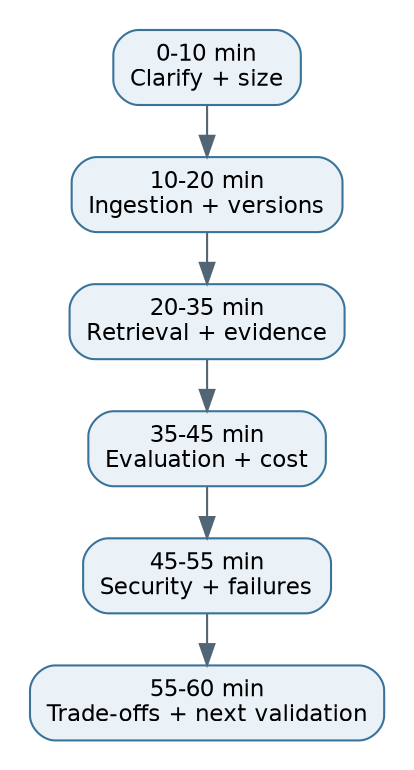

## Minutes 0-5: clarify
Interviewer: “Design an enterprise knowledge assistant.”

My answer: “I need users, access boundaries, query types, source formats, update rate, citation requirements and expected latency/cost. Are answers advisory or high-risk? Can we abstain? I will assume the hypothetical million-document, 100K-query/day platform, but I will validate chunks and peak traffic before sizing.”

Interruption: “Just use the newest policy.” Response: “Newest upload and currently effective policy can differ. I need explicit authority and temporal rules.”

## Minutes 5-10: estimate
My answer: “Average traffic is 1.16 QPS. I need peak distribution. At assumed 20 QPS and three-second mean, about 60 requests are in flight. If documents average 20 chunks, we have 20M vectors, or 61.44 GB raw at 768 float32 dimensions, excluding indexes/replicas. I sample before using this for provisioning.”

Interruption: “Why not one shard per tenant?” Response: “That simplifies some isolation but may create many tiny shards and overhead. I compare shared scope-enforced indexes with dedicated resources for heavy or regulated tenants.”

## Minutes 10-20: ingestion
My answer: “Connectors capture revisions, workers parse/OCR, preserve structure and provenance, normalize, chunk and enrich. Idempotent jobs write versioned lexical/vector indexes. Validation precedes a manifest switch. Deletion and revocation block access promptly and remove derived artifacts.”

Interruption: “The worker crashes after only vector writes.” Response: “The version remains unpublished. A durable job/reconciler completes or cleans the partial state.”

## Minutes 20-35: query and evidence
My answer: “Resolve access/date, route exact lookups, run lexical/dense in parallel for mixed search, fuse, rerank and pack complementary evidence. Generate with source IDs and verify material claims. Add graph retrieval for explicit relationships and bounded agents only for variable research tasks.”

Interruption: “Reranker confidence is 0.99.” Response: “That does not establish applicable, sufficient evidence or calibrated answer correctness. I check required facts and source validity.”

## Minutes 35-45: evaluation and cost
My answer: “Versioned golden sets include exact-ID, paraphrase, multi-hop, temporal, unanswerable and unauthorized slices. Measure candidate/context recall, support/correctness, citation quality, risk-coverage, latency and cost. Use controlled ablations and held-out thresholds. Inspect actual stage traces before optimizing.”

Interruption: “No labels.” Response: “Start with a privacy-reviewed representative sample and expert edge cases; adjudicate labels. Synthetic questions and model judges can assist, but do not replace calibration.”

## Minutes 45-55: failures and security
My answer: “Apply server-side access across every store/cache/tool/source link. Retrieved instructions are untrusted. Use read-only tools and bounded execution. Timeouts, backpressure, circuit breakers and validated degraded paths protect availability. Trace source IDs and versions safely. Test restore, revocation and index rollback.”

Interruption: “Vector DB is down.” Response: “Use scoped lexical fallback only where evaluated; otherwise explain missing evidence. Never claim the same coverage silently.”

## Minutes 55-60: decision and trade-offs
My answer: “My initial candidate is permission-aware hybrid RAG with versioned ingestion and evidence checks. The key risks are parsing quality, exact/semantic coverage, missing exceptions and access consistency. Graphs/agents are additions justified by target-slice gains. I would first validate source parsing, labeled retrieval and authorization before expanding scope.”


# 32. 150 interview questions and first-person answers

These concise revision cards supplement the deeper explanations and challenging follow-ups in Chapters 1-31. Use them for recall, then expand each answer with a diagram, example, failure mode and evaluation plan. They are not a claim that every topic has only one valid answer.

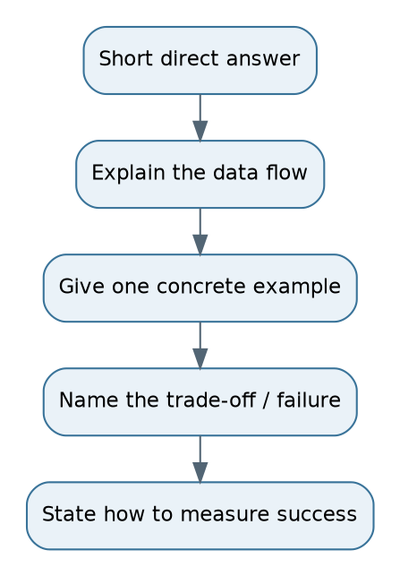

## Foundations and requirements

### Q001. What does RAG add to an LLM?
I add selected external evidence at answer time. I still need to measure retrieval errors and unsupported generation.

### Q002. Why can a retrieved answer still be wrong?
I may retrieve an outdated or inapplicable source, miss an exception, or generate a claim the evidence does not support.

### Q003. When would you fine-tune instead?
I use fine-tuning for behaviour, style or repeated task patterns. I keep freshness and citations in the evidence pipeline.

### Q004. Can long context replace retrieval?
For a small known source set, sometimes. At enterprise scale I still need authorization, source selection and manageable cost.

### Q005. What is parametric knowledge?
It is information encoded in model parameters, without a dependable per-fact source/version lookup.

### Q006. Retrieval versus reasoning?
I retrieve facts, then reason or compute over them. Neither step automatically validates the other.

### Q007. What is modular RAG?
I separate ingestion, routing, retrieval, ranking, generation and verification behind explicit contracts.

### Q008. Which requirements do you clarify first?
I ask about users, access, query types, authority, freshness, citations, latency, cost and acceptable abstention.

### Q009. Why is document count insufficient for sizing?
I need bytes, pages, chunk distribution, vector dimensions, update rate, replicas and peak query behaviour.

### Q010. How do you estimate mean concurrency?
I multiply arrival rate by mean duration in a stable interval, then separately plan for bursts and tail behaviour.

### Q011. What makes an SLO meaningful?
I define the population, time window, outcome and threshold, including how errors and timeouts are counted.

### Q012. What is a good first baseline?
I build representative ingestion, exact/lexical and dense retrieval, access checks and a labeled query set.

### Q013. What is the difference between a source and an index?
The source contains authoritative content. The index is a derived search representation that can be rebuilt.

### Q014. What is a token budget?
I budget instructions, history, evidence and output using the target tokenizer and model limits.

### Q015. What does production-ready mean here?
I require real integration, access/freshness checks, fault handling, observability and recovery evidence, not just a fluent demo.

## Ingestion and lifecycle

### Q016. Why keep original files?
I need reproducibility, source verification, improved reparsing and reliable citations back to original content.

### Q017. How do you parse scanned PDFs?
I use OCR plus layout handling and preserve page/region coordinates. I inspect numerical and column-order errors.

### Q018. What is ingestion idempotency?
Repeated delivery of one source revision should produce the same intended version without duplicate active chunks.

### Q019. What belongs in an idempotency key?
I include tenant, stable source identity, revision and pipeline version, matching the actual update semantics.

### Q020. Why at-least-once queues matter?
I expect duplicate deliveries and make writes/retries safe rather than assume each event happens exactly once.

### Q021. What goes to a DLQ?
I move permanently invalid or repeatedly failing jobs with safe diagnostics, source pointers and a defined repair path.

### Q022. How do you publish an index?
I validate the required versioned artifacts and switch a manifest or alias only when the complete version is ready.

### Q023. What about partial cross-store writes?
I leave the version unpublished and use durable job state plus reconciliation to complete or clean it.

### Q024. Content hash versus source identity?
A hash detects byte/content equality; source identity tracks ownership and lifecycle. Neither replaces tenant/access semantics.

### Q025. When must you re-embed?
I re-embed changed content or rebuild when the model/representation contract changes. Matching dimensions do not imply compatible spaces.

### Q026. How do you delete a document?
I block access promptly, remove original/derived/index/cache records under policy and track deletion completion.

### Q027. How do you handle ACL revocation?
I enforce current scope or tombstones immediately enough for the security requirement, independently of slow reindexing.

### Q028. Upload time versus effective time?
Upload time says when we received content. Effective time says when the policy or fact applies.

### Q029. How do you test freshness?
I measure source-change-to-searchable delay and verify the published revision, including update/delete/revocation cases.

### Q030. What do you preserve for tables?
I retain column/row labels, units, period, caption and coordinates, then use structured computation for exact aggregation.

## Chunking

### Q031. Why not embed the whole document?
Long documents mix topics, may truncate and give coarse citations. I compare document routing with local evidence chunks.

### Q032. Character versus token chunks?
Character count is cheap but does not control model input size. Token count uses the chosen tokenizer.

### Q033. How does recursive splitting work?
I try meaningful separators in order, then use finer boundaries until the maximum token size is met.

### Q034. How do you pick overlap?
I test boundary-failure cases and compare against zero overlap. Duplicate storage/context is a real cost.

### Q035. Is a 512-token chunk always good?
No. I test candidate sizes on required-fact coverage, answer quality, index cost and latency for the actual corpus.

### Q036. What is semantic chunking?
I split near changes in adjacent semantic representations, while enforcing size limits and protected structural spans.

### Q037. Percentile versus deviation breakpoints?
Percentiles select relative distance extremes; deviation rules compare to the distribution mean. Both need corpus-specific testing.

### Q038. What is parent-child retrieval?
I index small children for matching, then fetch larger authorized parents when extra context is needed.

### Q039. Can parent-child use recursive chunks?
Yes. Recursive defines boundaries; parent-child defines relationships between retrieval and context units.

### Q040. What is sentence-window retrieval?
I retrieve a sentence and expand nearby sentences, respecting section boundaries, permissions and context budget.

### Q041. What is proposition chunking?
I extract atomic factual statements, but I retain provenance and check that qualifiers were not lost.

### Q042. What is contextual enrichment?
I add source context before indexing, separating generated explanation from original evidence and validating it.

### Q043. What is late chunking?
I encode longer text first and pool token representations over selected spans, using a compatible model.

### Q044. Why AST chunking for code?
Symbols and syntax are meaningful boundaries. I still retain imports, file context and cross-file dependencies.

### Q045. When use LLM chunking?
Only when difficult structure benefits enough to justify cost, nondeterminism and source-boundary validation.

## Metadata and embeddings

### Q046. Which metadata is mandatory?
I need stable IDs, tenant/access scope, source/version, location, parent links, effective dates and representation versions.

### Q047. Hard filter versus soft boost?
Hard filters exclude results and need reliable constraints. Soft boosts express uncertain preferences without irreversibly hiding evidence.

### Q048. Can an LLM set access filters?
It can propose business intent. The server always resolves and enforces identity, tenant and access independently.

### Q049. Why store enrichment confidence?
It helps inspection and calibration, but I do not interpret an unvalidated generated number as a probability.

### Q050. What can query rewriting break?
It can change entities, requested dates or user intent. I preserve the original query and test rewrite effects.

### Q051. What is HyDE?
I generate hypothetical search text to embed, then retrieve real sources. The generated text is not evidence.

### Q052. When use multi-query retrieval?
When diverse formulations improve recall enough to justify added search cost and candidate noise.

### Q053. What is a bi-encoder?
It encodes query and document separately so document vectors can be prepared before queries arrive.

### Q054. What does cosine measure?
Vector angle similarity after accounting for magnitudes. It is not calibrated answer correctness.

### Q055. When do dot and cosine rankings agree?
For consistently unit-normalized vectors. Without normalization, vector magnitude also affects dot product.

### Q056. Why does embedding truncation matter?
A model can silently omit the answer-bearing end of a chunk before any vector search occurs.

### Q057. How do you choose embedding dimensions?
I compare quality and memory/latency trade-offs supported by the model, rather than assume more dimensions always help.

### Q058. How do you handle multilingual queries?
I evaluate cross-language retrieval and domain terminology, including code-switching, using representative labels.

### Q059. Why version the tokenizer/model?
Representation and truncation can change across versions, affecting reproducibility and compatibility.

### Q060. How do you migrate embedding models?
I build a separate compatible index, shadow/evaluate, publish by manifest and retain rollback without mixing spaces.

## Search internals and vectorless RAG

### Q061. What is an inverted index?
It maps terms to postings of matching document/chunk IDs and statistics, avoiding a full PDF scan at query time.

### Q062. How does BM25 use IDF?
Rarer query terms usually contribute more, subject to the implementation's IDF formula and tokenization.

### Q063. Why term-frequency saturation?
Repeated mentions should not increase relevance without bound, so BM25 gives diminishing returns.

### Q064. What does BM25 length normalization do?
It adjusts for longer indexed units containing more terms. I tune it against the chosen chunk/document granularity.

### Q065. Why keep exact keyword fields?
I need identifiers and versions to survive punctuation, stemming and analyzer transformations.

### Q066. Document versus chunk BM25?
Documents provide coarse topic context; chunks provide local evidence. I evaluate any document gate for missed relevant sources.

### Q067. What is vectorless RAG?
It retrieves using exact lookup, lexical indexes or hierarchy without dense embeddings, then grounds generation in sources.

### Q068. Is LLM tree navigation free?
No. It can add several model calls and miss branches due to misleading headings or summaries.

### Q069. How does HNSW search work?
It navigates a layered neighbour graph, then explores nearby candidates with a recall/latency search-effort trade-off.

### Q070. How does IVF work?
It searches selected vector clusters/cells rather than all vectors, trading probe effort against recall.

### Q071. What is PQ?
It compresses subvectors using learned codebooks, reducing storage with possible ranking accuracy loss.

### Q072. Why evaluate ANN against exact search?
I want to isolate approximate-index loss from embedding quality, filters or missing sources.

### Q073. Why can post-filtering fail?
A small global candidate list may contain no authorized items even when good eligible matches exist.

### Q074. Is FAISS a full database?
No. I must supply serving, persistence, metadata, authorization and recovery around the index library.

### Q075. How do you select a vector database?
I test filtered recall, updates, persistence, recovery, scale, operational burden and cost under the actual workload.

## Hybrid, reranking and context

### Q076. Why hybrid retrieval?
Keyword and semantic retrieval fail differently; I test whether their union improves relevant evidence coverage.

### Q077. Why not add BM25 and cosine scores?
Their scales and meanings differ. I use rank fusion or a validated normalization/calibration method.

### Q078. What is RRF?
I sum weighted reciprocal shifted ranks for each candidate. Missing results contribute zero.

### Q079. How do you choose the RRF constant?
I tune it on held-out ranking/answer metrics because it controls sensitivity to rank differences.

### Q080. Candidate K versus final N?
K sets retrieval/reranking coverage; N sets evidence/context selection. They have different costs and failure modes.

### Q081. Can reranking fix missing retrieval?
No. It can only reorder candidates already returned, so I measure candidate recall first.

### Q082. Why is a cross-encoder more expensive?
It jointly reads each query-document pair at runtime instead of reusing one stored document vector.

### Q083. What is ColBERT late interaction?
It matches separately encoded token vectors and aggregates their similarities, with richer storage/serving needs.

### Q084. Pointwise versus listwise reranking?
Pointwise scores each candidate; listwise compares a set and can introduce order/context-budget sensitivity.

### Q085. Is reranker score a probability?
Only if appropriately calibrated for the task and distribution. A high relevance score still does not prove support.

### Q086. Why deduplicate before generation?
Repeated spans waste tokens and can falsely look like independent corroboration.

### Q087. What does MMR optimize?
A balance of query relevance and novelty relative to selected results, under a tunable trade-off.

### Q088. How do you pack context?
I prioritize complete required facts, source boundaries and qualifiers, then fit the full prompt/output budget.

### Q089. What is lost-in-the-middle risk?
The model may underuse evidence in long contexts depending on placement and distraction, so I test ordering.

### Q090. When expand parents?
When small hits lack conditions or surrounding meaning, while enforcing scope and final token limits.

## Graphs and agents

### Q091. Why use a knowledge graph?
Explicit relationships help queries requiring joins or multi-hop paths across entities, when extraction quality is sufficient.

### Q092. Does a graph path prove a claim?
No. It proves stored connectivity. I verify entity identity, relation semantics, dates and original source support.

### Q093. What is entity resolution?
I map aliases and mentions to canonical identities, retaining uncertainty and reversible merge history.

### Q094. What belongs on graph assertions?
I store source spans/IDs, tenant/access, effective dates, extractor version and relation provenance.

### Q095. Why separate relations and assertions?
Several sources can support one relation; deleting one assertion should not wrongly erase or perpetuate the fact.

### Q096. How do you choose traversal paths?
I restrict relation types and scope, then rank paths by query relevance, applicability and complete source support.

### Q097. Is shortest path best evidence?
Not necessarily. Graph distance is not the same as semantic relevance or authoritative support.

### Q098. Community GraphRAG versus KG retrieval?
Community summaries support broad themes; entity-path retrieval supports explicit relation questions. Both need provenance.

### Q099. How do you avoid graph explosion?
I bound hops, fan-out, relation types, execution time and eligible subgraphs, then monitor path counts.

### Q100. Agent versus workflow?
A workflow follows defined transitions; an agent chooses actions from observations. Both need scoped tools and budgets.

### Q101. What belongs in agent state?
I store task plan, evidence references, gaps, safe action outcomes, progress and budgets, with trusted identity outside model control.

### Q102. What makes an agent retry useful?
It addresses a specific evidence gap with a changed query/tool or follows a meaningful state change.

### Q103. How do you stop loops?
I enforce deadline, spend/call limits and no-progress/repeated-result detection in server logic.

### Q104. When use human approval?
For consequential external actions or unresolved high-risk decisions under the task's authorization policy, not every read-only search.

### Q105. How do you evaluate multi-agent systems?
I compare task success, evidence consistency, duplicated work, safety and cost against a simpler single-orchestrator baseline.

## Evidence and generation

### Q106. Relevance versus sufficiency?
A passage may be topical while missing a condition. I test whether all required facts are supported.

### Q107. What is provenance?
The trace from a claim or chunk back to source version, location and processing steps.

### Q108. What is precomputed evidence metadata?
Source spans, hashes, authority labels, dates and extracted facts can be prepared before queries.

### Q109. What is runtime evidence verification?
I check whether applicable sources support the specific question and each generated material claim.

### Q110. How do you represent a claim verdict?
I store claim/source references, source versions, check type, verdict and verifier version under retention/access rules.

### Q111. What can deterministic checks verify?
Citation membership, IDs, types, dates, units and arithmetic, when the rule and data are reliable.

### Q112. What can NLI or LLM judges miss?
Negation, tables, temporal assumptions, invalid joins, hidden exceptions and ambiguous source authority.

### Q113. How do you handle conflicting sources?
I apply explicit authority/scope/time rules, then disclose or abstain on unresolved conflicts instead of silently merging.

### Q114. What is evidence coverage?
The supported share of predefined required facts, optionally weighted; duplicates do not create new coverage.

### Q115. Why not multiply all confidence scores?
They are often correlated, uncalibrated and measuring different objectives, so the product is not a justified probability.

### Q116. How do you calibrate answerability?
I compare signals to held-out correctness labels and choose a risk/coverage operating point by task slice.

### Q117. What makes a citation valid?
It resolves to an accessible source version and location; support additionally requires that the passage substantiates the claim.

### Q118. How should prompts handle retrieved instructions?
I mark them as untrusted source content, while server-side controls prevent capability or access escalation.

### Q119. When should the system abstain?
When required applicable evidence is missing, authority is unresolved or claim support fails under the defined policy.

### Q120. Should answers stream before verification?
Only under an explicit risk policy. For high-risk claims I verify before release or release verified segments.

## Evaluation and experiments

### Q121. What belongs in a golden example?
Question, identity/scope, date, corpus version, required facts, sources, acceptable answer/abstention and rubric.

### Q122. Why include unauthorized questions?
I need to verify no leakage across candidates, output, citations, caches or logs, not just answer correctness.

### Q123. Precision@K versus Recall@K?
Precision measures relevant share of returned results; recall measures share of all labeled relevant evidence found.

### Q124. What does MRR emphasize?
The position of the first relevant result, not complete evidence coverage for multi-fact questions.

### Q125. Why use nDCG?
It evaluates placement with graded relevance against the ideal ordering, under stated label/zero-relevance conventions.

### Q126. What is MAP?
Mean average precision over queries, sensitive to the positions of relevant items under an explicit cutoff denominator.

### Q127. How do you evaluate graph retrieval?
I test entity resolution, edge accuracy, complete supported path coverage and final answer quality.

### Q128. Correctness versus faithfulness?
Correctness compares to truth/expected facts; faithfulness compares claims to supplied evidence, which itself may be wrong.

### Q129. Citation precision versus recall?
Precision checks cited-claim support/attribution; recall checks coverage of material claims needing citations.

### Q130. How do you assess abstention?
I report wrong-answer risk against answer coverage and detect unnecessary refusal when evidence is sufficient.

### Q131. Can the same model generate and judge?
It can assist, but shared biases require human calibration, independent checks and versioned judge prompts.

### Q132. What is an ablation?
I remove or vary one component to identify which change produced the measured benefit or regression.

### Q133. Why paired evaluation?
The same queries reduce workload confounding, allowing more meaningful differences and uncertainty estimates.

### Q134. How do you avoid test-set leakage?
I separate tuning/test sets, version labels and avoid repeatedly selecting parameters on the final holdout.

### Q135. Offline versus online evaluation?
Offline labels diagnose quality and safety; controlled online tests measure real behaviour with monitoring and stop criteria.

## Production, security and debugging

### Q136. Why separate ingestion and queries?
Bulk parsing/indexing throughput should not consume resources needed for interactive latency.

### Q137. Which versions belong in traces?
I include corpus/index, parser/chunker, analyzer/embedding, reranker, generator/prompt and verifier versions where relevant.

### Q138. Why not sum stage P95 values?
Stage tail events may not coincide. I measure request P95 directly from complete traces.

### Q139. How do you calculate model cost?
I multiply actual input/output usage by current unit prices, then add tool, retrieval and infrastructure costs.

### Q140. Retrieval cache versus KV cache?
Retrieval cache stores search results; KV cache reuses model attention computation. Neither alone establishes current access or truth.

### Q141. What makes a cache key safe?
I include tenant, effective permissions, date, source/index version and relevant model/prompt versions, and revalidate access.

### Q142. Where must authorization apply?
Every lexical/vector, graph, parent, SQL, source-link, cache and audit path—not only the final answer.

### Q143. How do you defend prompt injection?
I treat documents as untrusted, constrain tools/destinations and enforce scope server-side, rather than rely only on prompts.

### Q144. What should not go in logs?
I avoid secrets, unnecessary raw sensitive text, unauthorized content and private reasoning; logs need access/retention controls.

### Q145. How do you handle dependency outages?
I use deadlines, bounded retries, circuit breakers and validated scoped fallback; otherwise I fail or abstain clearly.

### Q146. How do you debug low recall?
I trace expected sources through parsing, filtering, indexing and search, and compare ANN with exact eligible search.

### Q147. How do you debug good recall but bad answers?
I inspect rerank/packing losses, missing qualifiers, applicability, generation and verification before changing the model.

### Q148. What must deletion invalidate?
Original/derived/index/graph/summary/cache records under retention rules, with prompt access blocking and tracked completion.

### Q149. How do you prove disaster recovery?
I run restore drills and measure recovery objectives instead of assuming that having backups is enough.

### Q150. What is the strongest interview habit?
I state assumptions, draw the data path, explain trade-offs, name failure modes and propose measurable evidence of success.


# 33. Architecture challenges and design responses

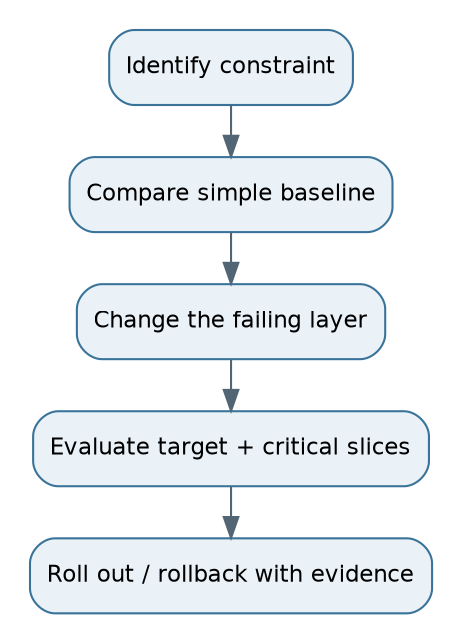

## 1. Ten million documents
Estimate chunks, bytes, update rate, shard distribution and rebuild time. Separate storage from serving capacity; benchmark filtered search. Use incremental ingestion, partition only where justified, batch background work and test backup/restore. Failure to prepare temporary rebuild capacity can block safe model migrations.

## 2. Healthcare knowledge assistant
Use approved, applicable sources with strict access and audit. Identify patient/clinical scope explicitly, protect PII and define escalation for uncertainty. Evaluate contraindication, temporal and unanswerable cases. Do not interpret retrieval similarity as medical confidence or claim that RAG makes autonomous clinical use safe.

## 3. Financial tables
Preserve headers, units, currencies and periods. Use layout-aware parsing and deterministic calculations or governed SQL. Cite cells/rows and assumptions. Validate that a number belongs to the requested entity and accounting period; matching digits alone is insufficient.

## 4. Multi-tenant enterprise
Derive scope from authenticated identity. Test every retrieval/graph/parent/cache/source-link path. Choose shared indexes versus dedicated resources based on isolation, scale and cost. Revalidate cache hits and propagate revocation promptly. Test near-identical cross-tenant records to expose accidental scope leakage.

## 5. Graph multi-hop
Define ontology and canonical IDs first. Store independent source assertions for edges. Restrict relation types/hops, fetch evidence for every join, and compare complete-path coverage against hybrid. Bad entity resolution can make a beautifully connected graph incorrect.

## 6. Low-latency agentic RAG
Keep simple questions on a deterministic route. Parallelize independent tool reads, cap calls/results, checkpoint progress and stop on no progress. Compare task success and P95/cost against a fixed workflow. If deadlines prevent sufficient research, return supported partial findings with gaps.

## 7. Vector-to-hybrid migration
Build a version-aligned lexical index, shadow queries and compare exact-ID/paraphrase slices. Tune fusion/reranking, test ACL/delete parity, canary and retain rollback. Do not copy arbitrary score weights from another corpus.

## 8. Low recall
Confirm relevant source exists and parsing is correct. Check restrictive filters, analyzer/tokenizer, chunk boundaries, embedding domain fit, truncation and ANN loss against exact search. Increase K only if the relevant source ranks just below cutoff and added work is justified. A corrupted source needs ingestion repair.

## 9. Forty-percent cost reduction
Set a measured baseline per successful task. Inspect model tokens, retrieval/rerank depth, agent retries and infrastructure. Test route simplification, context deduplication, safe caching and model tiering. Maintain critical quality and access gates. Report the observed reduction with uncertainty, not the target as an achievement.

## 10. Evaluation without golden data
Build a small representative expert-labeled set, add high-risk negatives, adjudicate ambiguity and version sources. Use judge-assisted labeling and production signals as supplements. Expand slices according to observed failure/uncertainty. Avoid declaring readiness from synthetic easy questions only.

**Interview pattern:** State constraints -> draw the changed data path -> name the failure mode -> define evidence of success -> describe rollback. The answer is stronger when it admits what remains unmeasured.


# 34. Revision sheets, glossary, formulas and references


## One-page architecture checklist
- Ingest: trusted connector, originals, parser/OCR, structure, hashes, versions, retry-safe jobs, source spans.
- Index: chunks, exact/lexical/dense representations, optional graph, access metadata, model/pipeline versions, validated publication.
- Query: authenticate, resolve date/scope, preserve intent, route, retrieve, fuse, rerank, expand, deduplicate and budget context.
- Evidence: applicability, authority, complete facts, contradictions, claim mapping, citations, abstention.
- Operate: safe caches, deadlines, quotas, backpressure, audit, quality/freshness traces, deletion, restore and rollback.
- Evaluate: representative labels, candidate/final-context metrics, answer support/correctness, access tests, slices, uncertainty, latency/cost.

## Formula sheet
| Quantity | Formula / caution |
|---|---|
| QPS | queries / seconds; daily average hides peak |
| Mean concurrency | arrival rate x mean duration in a stable interval |
| Raw vector bytes | chunks x dimensions x bytes per dimension |
| Cosine | dot(q,d)/(norm(q)*norm(d)); not answer confidence |
| BM25 | sum IDF x tf*(k1+1)/(tf+k1*(1-b+b*length/avglen)) |
| RRF | sum w/(c+rank), absent result contributes zero |
| Precision@K / Recall@K | relevant retrieved/K; relevant retrieved/all relevant |
| MRR | mean reciprocal rank of first relevant result |
| nDCG | discounted graded gain / ideal discounted gain |
| Coverage | supported required-fact weight / total required-fact weight |
| Call cost | input tokens x input unit price + output tokens x output unit price |
| Critical-path latency | dependent durations plus parallel maximum and overhead; measure total directly |

## Two-minute system-design answer
“I would build permission-aware, versioned ingestion and hybrid retrieval. Workers parse/OCR sources, preserve structure and citations, and create chunks with tenant, access and effective-date metadata. At query time I resolve scope, search lexical and vector indexes, fuse/rerank candidates, and pack complete evidence. The model drafts a cited answer; claim checks verify support or trigger abstention. I measure retrieval, correctness, authorization, freshness, latency and cost separately. Graph and agent routes are optional additions for relationship and variable research questions.”

Five-minute answer: Add one capacity estimate, idempotent publication, required-fact coverage, secure caching and a fallback. Fifteen-minute answer: Add schemas, RRF math, graph/agent criteria, evaluation design, deployment/restore, version migrations and explicit trade-offs.

## Interview traps
Do not equate relevance with support, cosine with calibrated confidence, graph paths with proof, schema-valid output with correctness, overlap with free recall, long context with complete evidence use, or passing a mocked test with service readiness. Never claim invented benchmark results or zero hallucinations. Explain what you measured and what remains an assumption.

## Compact glossary
ACL: resource access rules. ABAC/RBAC: attribute-/role-based authorization. ANN: approximate nearest-neighbour search. Bi-encoder: separate query/document encoding. Cross-encoder: joint pair scoring. CDC: change data capture. DLQ: dead-letter queue. Entailment: evidence supports a claim under its conditions. Effective time: when a fact/policy applies. Grounding: relating claims to external evidence. Idempotency: repetition does not create unintended duplicate effects. Manifest: published mapping of complete compatible versions. Provenance: trace back to source and transformations. Reranking: ordering a retrieved candidate subset. Tombstone: record that blocks deleted/revoked content pending cleanup.

## References and source notes
These are identifiable foundational references and official documentation pointers. They were not all fetched or verified live while writing. Product APIs, defaults, quotas, pricing and managed-service capabilities must be checked against the chosen version.

- Lewis et al. (2020), Retrieval-Augmented Generation for Knowledge-Intensive NLP Tasks: https://arxiv.org/abs/2005.11401
- Robertson and Zaragoza (2009), The Probabilistic Relevance Framework: BM25 and Beyond: https://doi.org/10.1561/1500000019
- Cormack, Clarke and Buettcher (2009), Reciprocal Rank Fusion: https://doi.org/10.1145/1571941.1572114
- Malkov and Yashunin, Efficient and Robust Approximate Nearest Neighbor Search Using HNSW: https://arxiv.org/abs/1603.09320
- Khattab and Zaharia (2020), ColBERT: https://arxiv.org/abs/2004.12832
- Edge et al. (2024), From Local to Global: A Graph RAG Approach: https://arxiv.org/abs/2404.16130
- Sarthi et al. (2024), RAPTOR: https://arxiv.org/abs/2401.18059
- Asai et al. (2023), Self-RAG: https://arxiv.org/abs/2310.11511
- Yan et al. (2024), Corrective Retrieval Augmented Generation: https://arxiv.org/abs/2401.15884
- Yao et al. (2022), ReAct: https://arxiv.org/abs/2210.03629
- Liu et al. (2023), Lost in the Middle: https://arxiv.org/abs/2307.03172
- Gunther et al. (2024), Late Chunking: https://arxiv.org/abs/2409.04701
- Official docs: https://github.com/pgvector/pgvector ; https://docs.opensearch.org/ ; https://qdrant.tech/documentation/ ; https://neo4j.com/docs/ ; https://docs.langchain.com/oss/python/langgraph/overview ; https://opentelemetry.io/docs/ ; https://genai.owasp.org/

## Coverage and limits
All 34 chapter areas from the uploaded outline are represented, including the chunking families, GraphRAG path/evidence distinction, vectorless document/chunk search, top-K/rerank/context distinction and precomputed/runtime verification. Chapter 32 supplies 150 revision questions. This is a detailed study handbook, not an exhaustive account of every algorithm or a fully implemented multi-service application. The original shared conversation remains unavailable. The lab and hypothetical examples are explicitly separated from production design and measured results.
