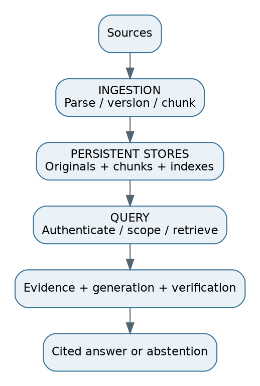

# 1. RAG fundamentals: what happens and why

## The problem before the solution
An LLM predicts tokens from its context and learned parameters. Its parameters are not a queryable, version-controlled copy of your company documents. Training may omit private material. Knowledge can be old. A plausible completion can be false. RAG supplies selected external evidence at answer time. It improves access to current knowledge, but retrieval mistakes and generation mistakes remain possible.

**Interview answer:** “I retrieve authorized, applicable evidence, then ask the model to answer from it with citations. I measure retrieval and answer quality separately. I do not assume that having a vector database means the answer is grounded.”

Read the figure as two clocks. Ingestion runs when sources change. Query processing runs when a user asks. The persistent stores connect them. Verification uses source metadata prepared earlier, but claim support depends on the current question and answer.

## One project, repeated throughout
Enterprise Knowledge Intelligence Platform: 1 million PDFs, DOCX, HTML, Markdown and scans; financial tables; HR/legal/security policies; many tenants; 100,000 queries/day; frequent updates; citations; multi-hop questions. These are hypothetical requirements.

Question A: “Can a Pakistan employee carry unused leave into 2027?” Question B: “Which vendors used by Team Atlas are affected by the new retention policy?” Question C: “What does section 7 of HR-42 version 3 say?” These questions stress applicability, relationships and exact lookup respectively.

## Knowledge, retrieval and reasoning
Parametric knowledge lives in model weights. External knowledge lives in files, records and indexes. Retrieval selects evidence; reasoning combines evidence and derives conclusions. A retriever cannot prove a numerical calculation. A fluent generator cannot establish that a cited source exists. Use deterministic tools for arithmetic and authoritative record queries.

Tokens are model-specific units, not words. The context window holds instructions, history, evidence and output budget. Reserve space for the answer. “Fits in context” does not mean “the model reliably uses every fact.” Large distracting contexts can reduce accuracy.

| Choice | Best fit | What it does not solve |
|---|---|---|
| RAG | Fresh/private source-grounded answers | Bad sources, weak retrieval, unsupported reasoning |
| Fine-tuning | Style, tool behaviour, specialized task patterns | Reliable per-document updates, citations or deletion |
| Long context | A small known set of relevant documents | Selecting authorized/current sources at large scale |
| Search interface | Users want to inspect documents | Multi-source answer synthesis |
| SQL/tools | Exact structured facts and computations | Unstructured discovery without a retrieval layer |

Naive RAG is retrieve once then generate. Advanced RAG improves parsing, retrieval, reranking and context. Modular RAG separates these functions so you can replace or route them. These are useful design categories, not standardized protocol names.

**Failure:** A model answers from old memory despite a new policy in context. **Fix:** Strengthen evidence selection and prompting, check material claims, test conflicting-version cases, and abstain if the current evidence is insufficient.

**Follow-up:** “Does RAG prevent hallucinations?” **Response:** “No guarantee. I can enforce source access, validate citations, measure unsupported claims and limit answering when evidence is weak.”
