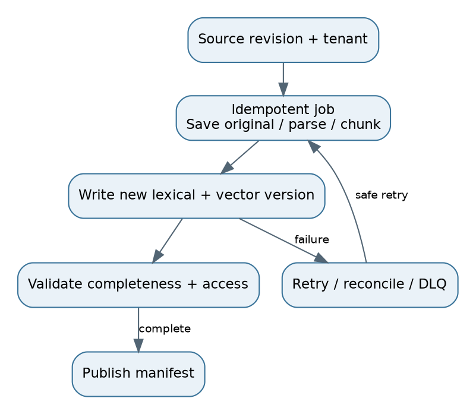

# 3. Ingestion: files to searchable, versioned evidence

## Step-by-step pipeline
1. A connector reads a permitted source through an API, batch scan, stream or CDC event. Capture source ID, revision, tenant and change time. Use checkpoints so restarts resume safely.
2. Save original bytes in object storage. Enforce file size/type, decompression and parser limits. Documents are untrusted inputs.
3. Parse text, headings, page locations, tables and images. DOCX has logical structure; PDFs may have visual layout without semantic order. HTML needs main-content extraction, link handling and boilerplate removal. Markdown headings are useful boundaries.
4. OCR scanned pages, retaining coordinates and confidence indicators. Sample outputs with numbers, columns and unusual fonts. OCR can turn “10” into “IO”; retrieval quality cannot repair corrupted facts reliably.
5. Normalize whitespace, encoding and repeated headers carefully. Preserve units, punctuation in IDs, table labels and meaningful code indentation.
6. Hash content and compare revisions. Deduplicate within valid ownership/access boundaries. Identical text across tenants does not authorize merging their permissions.
7. Chunk, enrich and index. Preserve source spans from normalized chunks back to original pages or sections.
8. Validate the new version. Publish only after all required stores are ready. Readers resolve a complete manifest or active alias, never a partly written version.

## Idempotency and retries
Use an idempotency key such as tenant + source ID + source revision + pipeline version. Queue delivery is often at least once. A repeated event should upsert the same pending version rather than create another active copy. Persist job stages and errors. Retry transient failures with bounded exponential backoff and jitter. Put invalid documents in a dead-letter queue with safe diagnostics and source references.

Cross-store writes rarely share one transaction. Use an outbox/job state machine and reconciliation: pending -> parsed -> indexed -> validated -> published. A worker crash between vector and lexical writes must be discoverable. Only the manifest switch makes the version visible.

## Freshness, update and delete
Store both ingestion time and effective time. A file uploaded today can describe last year's policy. For incremental updates, reprocess changed sections only when chunk identities and boundaries remain valid. A parser/chunker/model change may require a versioned rebuild even if raw bytes did not change.

Permission revocation should block access promptly through an authoritative scope check or tombstone. Do not wait for embeddings to be regenerated. Deletion covers chunks, vectors, graph facts, community summaries, cached answers, derived artifacts and the applicable backup-retention process. Track completion, not just the original delete event.

**Stored:** Original bytes, parse/layout artifacts, content hashes, source revisions, pipeline versions, job history, publication manifest and provenance. **Runtime:** Resolve only accessible published versions. **Evaluation:** Measure source-change-to-searchable delay, duplicate active records, parsing accuracy, failed-job age and revocation delay.

**Interview answer:** “Ingestion is a versioned state machine. I make each stage retry-safe, validate complete outputs, and publish atomically through a manifest.”

**Follow-up:** “A new index is 90% complete. Can we use it?” **Response:** “Not as the complete version. Keep the previous valid index active or expose explicitly scoped partial results only under a defined product contract.”
