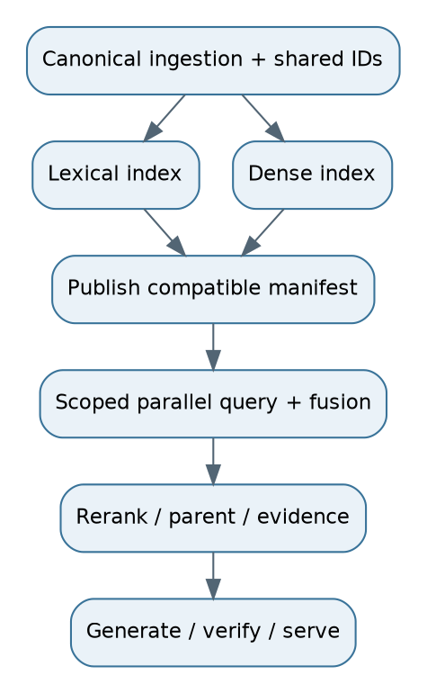

# 11. Production hybrid RAG: the default enterprise candidate

## Ingestion and publication
Parse files once into canonical chunks. Store originals and provenance. Build BM25 postings and dense vectors from those versioned chunks. Publish a manifest that records chunker, analyzer, embedding and index versions. The lexical and dense branches must agree on IDs, current versions and access semantics. Different physical stores do not justify different permission rules.

## Query path
Authenticate -> resolve access and requested time -> route exact lookups when appropriate -> run lexical/dense in parallel -> fuse -> deduplicate -> cross-encoder rerank -> authorized parent expansion -> evidence sufficiency/authority checks -> grounded generation -> claim/citation verification -> answer or abstain.

For A, lexical search identifies “carry forward” and policy codes; dense search finds “unused annual leave.” Parent expansion retrieves the eligibility subsection. A verifier checks that the cap, eligibility and effective date are all supported. This is a complete question answer, not just a highly relevant passage.

## Operations and degradation
Deploy query APIs independently from ingestion worker pools. Limit model/reranker concurrency. Cache scope-safe intermediate results. Use version-aware aliases, health checks, retries, timeouts and measured rollback. If dense search fails, lexical-only operation may be acceptable for some query classes. It must still enforce access and acknowledge insufficient evidence. Partial infrastructure failure is not permission to invent an answer.

## Choosing parameters
Run lexical, dense and union baselines. Tune branch K for recall, fusion for useful candidate order, reranker depth for quality/latency, and final context for fact coverage per token. Do not tune all at once without controlled comparisons. A complex pipeline can hide a broken branch if only final answers are inspected.

**Stored:** Canonical chunks, both indexes, manifests, source spans and permission references. **Runtime:** Auth scope, query transformations, fusion/reranking, parent fetch and evidence checks. **Audit:** Candidate IDs and rank transitions, model versions and final source mapping. **Deployment:** API + workers + stores + model gateway + monitoring.

**Interview answer:** “Hybrid is a strong enterprise starting candidate because exact terms and paraphrases coexist. Its value must show up in labeled slices, and both branches must obey the same version and permission contract.”

**Follow-up:** “What if hybrid is slower without quality improvement?” **Response:** “Keep the simpler route for those queries, or remove the branch. Architectural fashion is not a success metric.”
