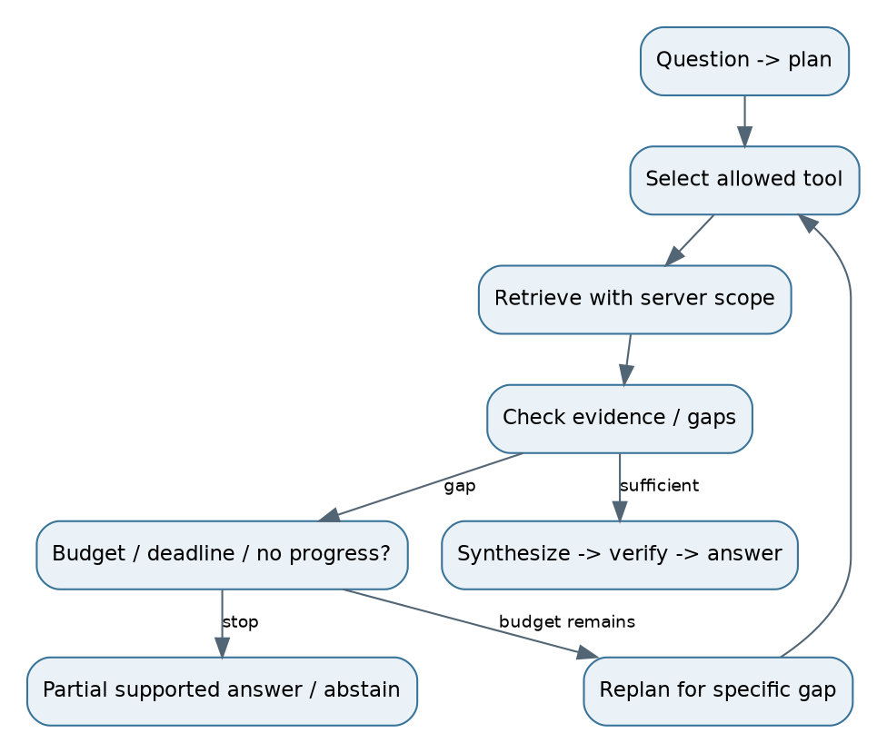

# 14. Agentic RAG: bounded adaptive evidence gathering



## Workflow vs agent
A deterministic workflow follows predetermined steps. An agent chooses actions using current observations. ReAct-style patterns interleave action selection and tool observations. Production orchestration should expose structured plans, tool calls and outcomes for audit; it need not record or reveal private chain-of-thought. LangGraph is one way to encode state transitions and checkpoints, not a requirement for all RAG systems.

Ingest/index the same authorized evidence as the underlying tools: lexical, vector, graph and SQL where justified. Store source versions and provenance. At runtime the agent decides which tool or query to use, evaluates evidence gaps, then stops when sufficient or bounded by policy. Deploy a stateful orchestrator with durable checkpoints, read-only retrieval services and enforced budgets. Persisted state survives a worker crash; running processes and open connections do not.

## Concrete state and contracts
```json
{
  "request_id":"r17", "question":"Which Atlas vendors changed obligations?",
  "plan":["find vendors","compare policy versions"],
  "evidence_ids":[], "gaps":["historical retention policy"],
  "steps_used":0, "status":"retrieving",
  "budget":{"max_tool_calls":4,"deadline_ms":5000}
}
```
The numbers are illustrative policy limits, to be chosen from task-success/latency experiments. Carry identity and trusted scope outside model-editable state. Persist only permitted data under the request's retention policy.

Tool example: `search(query, business_filters) -> [{chunk_id, source_version, text, citation_ref}]`. Server injects tenant/ACL constraints. Tool validates schema, limits query/result sizes, enforces timeouts and uses least privilege. A model may request a different topic; it cannot request another tenant. Treat tool output and retrieved instructions as untrusted content.

## Transition logic
Question -> plan -> choose tool -> retrieve -> check required facts. If sufficient, synthesize -> verify -> answer. If a specific gap exists, reformulate or use another tool. If no progress, budget exhaustion, repeated result sets or deadline, stop and return supported partial findings or abstain. A retry should test a changed strategy, not repeat the same failed request indefinitely.

Illustrative pseudocode:
```python
while budget.remaining() and state.has_gap:
    action = choose_allowed_action(state)
    result = execute_with_server_scope(action, identity)
    state = update_evidence_and_gaps(state, result)
    if no_progress(state):
        break
return verify_and_answer_or_abstain(state)
```

Checkpoints need concurrency/version controls so two retries do not execute an external action twice. Retrieval should be read-only. Consequential writes need explicit authorization and idempotency. Conversation memory helps interpret references; it is not authoritative evidence.

## When autonomy pays
For B plus “compare old and new obligations,” the agent may discover that a historical policy is missing and fetch it. A fixed one-shot pipeline may stop too early. For C's exact lookup, planning is wasted work. Evaluate task success, valid tool choice, evidence acquisition, recovery, bounded termination, permission failures, latency and spend. A longer successful trace is not better than a short successful one.

**Interview answer:** “I use a deterministic pipeline by default, then bounded agents for workloads that need adaptive search. Every action stays inside server-enforced scope and resource budgets.” **Follow-up:** “Why multi-agent?” **Response:** “Only when decomposed tasks can benefit from parallel specialization enough to offset duplicated work and coordination errors. More agents are not inherently more reliable.”
