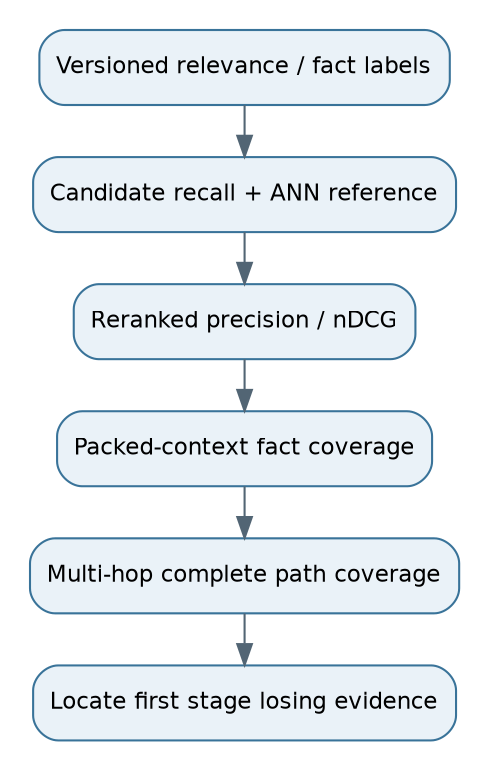

# 20. Retrieval metrics with worked calculations

## Definitions
Precision@K = relevant retrieved in top K / K. Recall@K = relevant retrieved in top K / total labeled relevant items. Hit@K is 1 if any relevant item appears, else 0, averaged over queries. Reciprocal rank is 1 / rank of first relevant item; MRR averages it. If none appears, reciprocal rank is zero. State cutoff and padding conventions when fewer than K items return.

AP sums precision at each relevant rank and divides by total relevant items under the stated cutoff convention. MAP averages AP across queries. DCG@K = sum_r (2^rel_r - 1)/log2(r+1). nDCG divides by ideal DCG for that query. Graded labels reward strongly relevant evidence more than weak topical matches. Define handling for queries with no relevant items; they need answerability/abstention evaluation rather than an undefined recall.

## One consistent calculation
Top three results have binary relevance [1,0,1]; there are four relevant items overall. Precision@3=2/3=0.667. Recall@3=2/4=0.5. Hit@3=1. RR=1. AP@3 using total relevant denominator is (1 + 2/3)/4=0.417. Other libraries may normalize cutoff AP differently; document your implementation.

DCG@3=1/log2(2)+1/log2(4)=1.5. Ideal top three are all relevant: IDCG=1+1/log2(3)+1/log2(4)=2.131. nDCG@3≈0.704. These values describe different properties; high first-hit performance does not mean all required evidence was found.

## Context, graph and multi-hop metrics
Context precision measures useful selected evidence under a declared labeling unit. Context recall measures required evidence/facts covered. Tools use different definitions, so record exact prompts and denominators. Duplicate overlapping chunks can inflate counts without improving coverage. Measure distinct facts and original source spans.

For B, retrieving two out of three needed relations can make a complete path impossible. Track complete-path coverage, entity-resolution correctness and edge support. Candidate recall, reranker quality and final context coverage diagnose different bottlenecks. Compare ANN results with exact eligible-vector search to isolate approximate-index loss.

**Interview answer:** “Recall tells me missing evidence; precision tells me noise; ranking metrics tell me placement. I measure them at each selection stage and include complete multi-hop evidence, not only one relevant hit.”

**Follow-up:** “Can Recall@K exceed 1?” **Response:** “Not under the standard set-based definition. Duplicate counting or inconsistent labels usually explains that result.”
