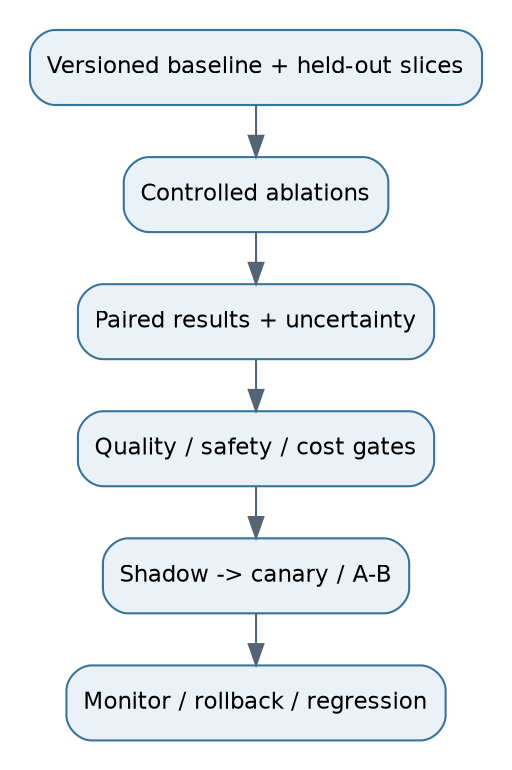

# 23. Experiments, ablations and release decisions

## Experiment order
Build exact lookup and BM25/dense baselines. Compare hybrid candidate recall. Test chunk sizes and overlap. Add reranking and parent expansion. Evaluate evidence/claim checks. Only then compare graph or agent additions on their intended relationship/research slices. Preserve a simple baseline throughout.

Record corpus, labels, scope, model/analyzer/index versions, parameters, code commit, cost basis and run ID. A result without reproducible context is hard to interpret. Never compare a new system on an easier query set against an old score from a different corpus snapshot.

## Ablation logic
If hybrid plus reranking improves, compare lexical-only, dense-only, hybrid without reranking and hybrid with reranking to locate the gain. For chunking, hold retrieval/model settings stable initially, then retune fairly if a representation's optimal K changes. A single fixed K can unfairly favour one chunk size because candidate token totals differ.

Use paired comparisons on the same queries. Bootstrap intervals or suitable paired statistical tests quantify uncertainty. Account for multiple experiments and avoid repeatedly tuning on the final test set. Report exact-ID, temporal, OCR, table, multi-hop, unanswerable and restrictive-access slices. Inspect error examples as well as aggregate metrics.

## Offline to online
Offline gates check quality, isolation, freshness, latency and cost. Shadow traffic reveals operational behaviour without changing answers. Canary/A/B rollout compares validated candidates under defined traffic assignment and stop criteria. User clicks and thumbs-up are useful but biased by ranking, presentation and question difficulty. Retain expert audits and regression sets.

Thresholds should be selected against a desired wrong-answer risk and supported by calibration data. A lower answer rate can improve precision; report both. Quality can regress after a model or source update even when the code did not change.

**Interview answer:** “I change one factor at a time where possible, keep versioned runs, report uncertainty and slices, and make rollout contingent on critical safety gates rather than one average score.”

**Follow-up:** “What result would convince you agents help?” **Response:** “A meaningful task-success improvement on variable research tasks, with complete evidence and acceptable tail latency/cost, compared to the best fixed workflow—not just one impressive demo.”
