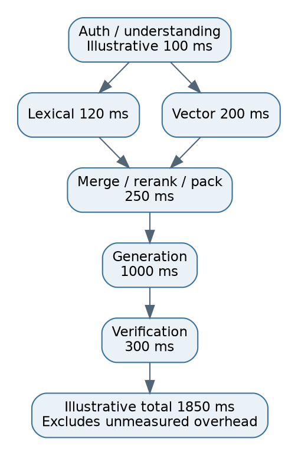
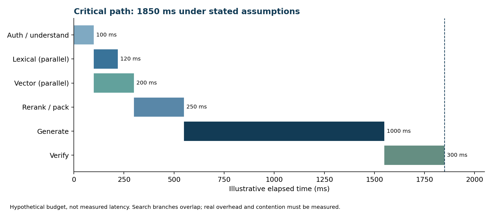

# 25. Performance, latency budgets and cost

## Measure distributions
P50 is the median; P95 means 95% of measured requests are at or below that latency; P99 captures further tail behaviour. Report the workload, time window and failures/timeouts policy. Stage P95 values do not sum to request P95 because stage tails need not happen on the same request.

Hypothetical serial budget: auth/understanding 100 ms; parallel lexical/vector retrieval 200 ms; rerank/pack 250 ms; generation 1,000 ms; verification 300 ms. Total under those assumptions is 1,850 ms. If lexical takes 120 ms and vector 200 ms concurrently, search is approximately 200 ms plus coordination overhead, not 320 ms. Real traces determine actual values and shared-resource contention.

## Latency levers
Avoid unnecessary LLM query transformations. Batch embeddings and reranking within latency limits. Bound candidate counts and parent expansion. Cache compatible intermediate results. Parallelize independent searches; do not parallelize dependent steps that need prior evidence. Use admission control and backpressure instead of building an unbounded queue. Separate bulk ingestion from query resources. A model provider quota can be the bottleneck even with spare CPU.

Quantization/compression can reduce memory and improve throughput but may lose recall. Benchmark on eligible, filtered queries. Warm common models/connections where appropriate and measure cold starts. Stream only under the chosen verification policy.

## Cost calculation
Let input price be hypothetical $1 per million tokens and output price $4 per million. A query using 3,000 input and 500 output tokens costs 0.003+0.002=$0.005 in that model call. At 100,000 queries/day, that is $500/day for those calls alone. Add embeddings, reranking, agent retries, storage/search, compute, network and operational costs. These are arithmetic examples, not current provider prices.

Track per-successful-task cost as well as per-call cost. A cheap call that fails and retries five times is not cheap task execution. Optimize the dominant costs using actual traces. A proposed 40% reduction is a target, not a result until quality, access and workload are held comparable.

## Cache semantics
Embedding cache reuses encoded text for the same model/version. Retrieval cache reuses candidates for compatible scope and index version. Answer cache reuses a verified response only under compatible question, permissions, source/date and model/prompt versions. KV caching reuses model attention computation; it does not itself prove source freshness or answer correctness.

Cache keys need tenant, effective access scope, source/index version and requested date. Revalidate current authorization on a hit. Semantic cache similarity can confuse “2026” and “2027,” different IDs, or employee and contractor eligibility. Use conservative matching and evaluate leakage/staleness cases.

**Interview answer:** “I optimize verified useful answers per unit cost and latency. I measure the critical path, token distribution and retries before reducing quality-sensitive work.”

## Quantitative latency visual

The lexical branch finishes at 220 ms; dense finishes at 300 ms. The next dependent stage starts at 300 ms. This chart makes the overlap visible. It is a worked budget, not an observed trace or percentile chart.
