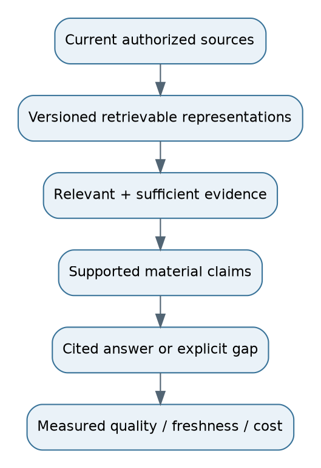

# 34. Revision sheets, glossary, formulas and references

## One-page architecture checklist
- Ingest: trusted connector, originals, parser/OCR, structure, hashes, versions, retry-safe jobs, source spans.
- Index: chunks, exact/lexical/dense representations, optional graph, access metadata, model/pipeline versions, validated publication.
- Query: authenticate, resolve date/scope, preserve intent, route, retrieve, fuse, rerank, expand, deduplicate and budget context.
- Evidence: applicability, authority, complete facts, contradictions, claim mapping, citations, abstention.
- Operate: safe caches, deadlines, quotas, backpressure, audit, quality/freshness traces, deletion, restore and rollback.
- Evaluate: representative labels, candidate/final-context metrics, answer support/correctness, access tests, slices, uncertainty, latency/cost.

## Formula sheet
| Quantity | Formula / caution |
|---|---|
| QPS | queries / seconds; daily average hides peak |
| Mean concurrency | arrival rate x mean duration in a stable interval |
| Raw vector bytes | chunks x dimensions x bytes per dimension |
| Cosine | dot(q,d)/(norm(q)*norm(d)); not answer confidence |
| BM25 | sum IDF x tf*(k1+1)/(tf+k1*(1-b+b*length/avglen)) |
| RRF | sum w/(c+rank), absent result contributes zero |
| Precision@K / Recall@K | relevant retrieved/K; relevant retrieved/all relevant |
| MRR | mean reciprocal rank of first relevant result |
| nDCG | discounted graded gain / ideal discounted gain |
| Coverage | supported required-fact weight / total required-fact weight |
| Call cost | input tokens x input unit price + output tokens x output unit price |
| Critical-path latency | dependent durations plus parallel maximum and overhead; measure total directly |

## Two-minute system-design answer
“I would build permission-aware, versioned ingestion and hybrid retrieval. Workers parse/OCR sources, preserve structure and citations, and create chunks with tenant, access and effective-date metadata. At query time I resolve scope, search lexical and vector indexes, fuse/rerank candidates, and pack complete evidence. The model drafts a cited answer; claim checks verify support or trigger abstention. I measure retrieval, correctness, authorization, freshness, latency and cost separately. Graph and agent routes are optional additions for relationship and variable research questions.”

Five-minute answer: Add one capacity estimate, idempotent publication, required-fact coverage, secure caching and a fallback. Fifteen-minute answer: Add schemas, RRF math, graph/agent criteria, evaluation design, deployment/restore, version migrations and explicit trade-offs.

## Interview traps
Do not equate relevance with support, cosine with calibrated confidence, graph paths with proof, schema-valid output with correctness, overlap with free recall, long context with complete evidence use, or passing a mocked test with service readiness. Never claim invented benchmark results or zero hallucinations. Explain what you measured and what remains an assumption.

## Compact glossary
ACL: resource access rules. ABAC/RBAC: attribute-/role-based authorization. ANN: approximate nearest-neighbour search. Bi-encoder: separate query/document encoding. Cross-encoder: joint pair scoring. CDC: change data capture. DLQ: dead-letter queue. Entailment: evidence supports a claim under its conditions. Effective time: when a fact/policy applies. Grounding: relating claims to external evidence. Idempotency: repetition does not create unintended duplicate effects. Manifest: published mapping of complete compatible versions. Provenance: trace back to source and transformations. Reranking: ordering a retrieved candidate subset. Tombstone: record that blocks deleted/revoked content pending cleanup.

## References and source notes
These are identifiable foundational references and official documentation pointers. They were not all fetched or verified live while writing. Product APIs, defaults, quotas, pricing and managed-service capabilities must be checked against the chosen version.

- Lewis et al. (2020), Retrieval-Augmented Generation for Knowledge-Intensive NLP Tasks: https://arxiv.org/abs/2005.11401
- Robertson and Zaragoza (2009), The Probabilistic Relevance Framework: BM25 and Beyond: https://doi.org/10.1561/1500000019
- Cormack, Clarke and Buettcher (2009), Reciprocal Rank Fusion: https://doi.org/10.1145/1571941.1572114
- Malkov and Yashunin, Efficient and Robust Approximate Nearest Neighbor Search Using HNSW: https://arxiv.org/abs/1603.09320
- Khattab and Zaharia (2020), ColBERT: https://arxiv.org/abs/2004.12832
- Edge et al. (2024), From Local to Global: A Graph RAG Approach: https://arxiv.org/abs/2404.16130
- Sarthi et al. (2024), RAPTOR: https://arxiv.org/abs/2401.18059
- Asai et al. (2023), Self-RAG: https://arxiv.org/abs/2310.11511
- Yan et al. (2024), Corrective Retrieval Augmented Generation: https://arxiv.org/abs/2401.15884
- Yao et al. (2022), ReAct: https://arxiv.org/abs/2210.03629
- Liu et al. (2023), Lost in the Middle: https://arxiv.org/abs/2307.03172
- Gunther et al. (2024), Late Chunking: https://arxiv.org/abs/2409.04701
- Official docs: https://github.com/pgvector/pgvector ; https://docs.opensearch.org/ ; https://qdrant.tech/documentation/ ; https://neo4j.com/docs/ ; https://docs.langchain.com/oss/python/langgraph/overview ; https://opentelemetry.io/docs/ ; https://genai.owasp.org/

## Coverage and limits
All 34 chapter areas from the uploaded outline are represented, including the chunking families, GraphRAG path/evidence distinction, vectorless document/chunk search, top-K/rerank/context distinction and precomputed/runtime verification. Chapter 32 supplies 150 revision questions. This is a detailed study handbook, not an exhaustive account of every algorithm or a fully implemented multi-service application. The original shared conversation remains unavailable. The lab and hypothetical examples are explicitly separated from production design and measured results.
